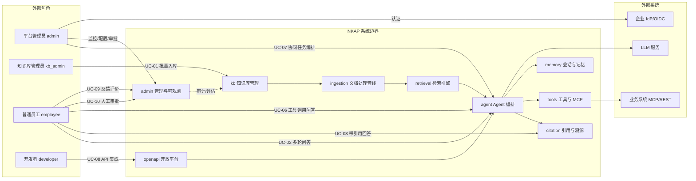

# 星枢 Nexus · 企业智能知识库与问答智能体平台 用户角色与核心用例

> **版本**：v0.2 ｜ **作者**：AI 助手 ｜ **状态**：基线 ｜ **更新日期**：2026-10-29
> **上游基线**：[项目基线与统一约定](../00-项目基线/项目基线与统一约定.md)
> **适用阶段**：需求分析（Phase 2）
> **技术栈**：Java 21 + Spring Boot 3.2+ + Spring WebFlux + Spring Security 6 + Spring AI 1.0 + LangChain4j + LangGraph4j + PostgreSQL 16/pgvector + Redis 7 + RabbitMQ 3.13 + MinIO + WebFlux SseEmitter + MCP + Langfuse
> **配套文档**：[04-需求规格说明书](04-需求规格说明书.md)、[06-非功能性需求与数据规则](06-非功能性需求与数据规则.md)

---

## 0. 文档说明

1. 本文档定义 NKAP 的**用户画像**、**核心用例**、**用例图**与**典型用户旅程**，用于把功能需求（04 文档）转化为可验证的交互场景。
2. 角色标识与基线一致：`admin`（平台管理员）、`kb_admin`（知识库管理员）、`employee`（普通员工）、`developer`（开发者）。
3. 用例优先级使用 MoSCoW；阶段归属标注 MVP / V1 / V2。
4. 用例中的模块标识（kb/ingestion/retrieval/agent/tools/memory/citation/admin/openapi）与基线一致。
5. 用例描述聚焦「谁、在什么条件下、做什么、得到什么结果」，不涉及代码与实现细节。

---

## 1. 用户画像

### 1.1 平台管理员（admin）

| 维度 | 内容 |
|---|---|
| 职责 | 管理租户、模型接入、配额、审计策略与系统配置，保障平台稳定与合规。 |
| 典型诉求 | 一屏看到系统健康与成本；能对租户限流；能快速定位异常问答。 |
| 使用频率 | 每日（运维巡检）+ 按需（配置变更）。 |
| 痛点 | 模型与向量库组件多、排障链路长；成本与配额容易失控；合规审计要求高。 |
| 关键交互 | 通过 admin 模块查看 Langfuse trace、Prometheus 指标与审计日志；配置模型路由与租户配额。 |

### 1.2 知识库管理员（kb_admin）

| 维度 | 内容 |
|---|---|
| 职责 | 创建空间、上传/批量导入文档、配置标签与切分、维护文档权限与状态。 |
| 典型诉求 | 批量入库要稳、要快、失败要能查；权限配置要简单且不出差错。 |
| 使用频率 | 每周多次（知识更新）。 |
| 痛点 | 文档格式杂、扫描件多；解析失败原因不透明；权限配错导致越权风险。 |
| 关键交互 | 通过 kb 模块管理空间与文档；通过 ingestion 任务状态与解析质量报告定位失败。 |

### 1.3 普通员工（employee）

| 维度 | 内容 |
|---|---|
| 职责 | 在知识库中提问、阅读带引用的答案、跳转原文、对答案反馈评价。 |
| 典型诉求 | 2 个点击内得到可信答案；引用能点开验证；答不上来时明确告知。 |
| 使用频率 | 每日高频。 |
| 痛点 | 找不到资料或找到但不可信；答案与自己权限不符；长文档要自己读。 |
| 关键交互 | 通过 agent 模块发起问答，接收 SseEmitter 流式答案与 citation 引用角标。 |

### 1.4 开发者（developer）

| 维度 | 内容 |
|---|---|
| 职责 | 通过 OpenAPI 集成问答能力、管理 API Key、配置 Webhook、对接业务系统工具。 |
| 典型诉求 | 文档清晰、鉴权简单、配额可控、事件可订阅、联调环境隔离。 |
| 使用频率 | 项目期内持续。 |
| 痛点 | 接口变更无通知；限流不透明；缺少沙箱；Webhook 丢事件。 |
| 关键交互 | 通过 openapi 模块管理 API Key、配额与 Webhook；按 SpringDoc OpenAPI 文档联调。 |

### 1.5 角色能力矩阵

| 能力 | admin | kb_admin | employee | developer |
|---|---|---|---|---|
| 空间/文档/权限管理 | ✅ 全租户 | ✅ 本空间 | ❌ | ❌ |
| 文档上传与批量导入 | ✅ | ✅ | ❌ | ❌ |
| 问答与引用查看 | ✅ | ✅ | ✅ | ✅ |
| 反馈与评价 | ✅ | ✅ | ✅ | ✅ |
| 系统配置与审计 | ✅ | ❌ | ❌ | ❌ |
| OpenAPI/API Key | ✅ | ❌ | ❌ | ✅ |
| 工具与 MCP 接入 | ✅ | ❌ | ❌ | ✅ |

---

## 2. 核心用例

> 用例编号规范：`UC-` + 两位序号。每个用例给出参与者、前置条件、主流程、后置条件、异常流、优先级。

### UC-01 文档批量入库

| 字段 | 内容 |
|---|---|
| 编号 / 名称 | UC-01 文档批量入库 |
| 参与者 | `kb_admin`、系统（ingestion） |
| 前置条件 | `kb_admin` 已登录；目标空间存在且具备上传权限；已准备导入模板与文件包。 |
| 主流程 | 1. `kb_admin` 选择空间并上传导入文件（≤ 500 个）或打包文件。 2. 系统校验格式与大小，生成导入批次并投递到 RabbitMQ 队列。 3. `ingestion` 异步执行解析（Apache Tika/PDFBox/POI + OCR）、切分、向量化（bge-m3）、混合索引（pgvector + Lucene BM25）。 4. 状态机依次流转：草稿 → 解析中 → 待审核 → 已发布。 5. 系统生成导入报告（成功/失败明细）。 |
| 后置条件 | 文档进入「已发布」并可检索；导入报告可下载；审计日志完整。 |
| 异常流 | 文件格式不支持 → 该条记为失败并提示；重复文档 → 触发版本管理或提示跳过；解析失败 → 重试 3 次后入死信队列并告警。 |
| 优先级 | Must（MVP） |
| 关联需求 | KB-002、KB-006、KB-007、ING-001、ING-007 |

### UC-02 多轮问答

| 字段 | 内容 |
|---|---|
| 编号 / 名称 | UC-02 多轮问答 |
| 参与者 | `employee`、系统（agent、retrieval、memory） |
| 前置条件 | `employee` 已登录；至少有一个已发布空间；模型服务可用。 |
| 主流程 | 1. `employee` 发起会话并提问，WebFlux 以 SseEmitter 建立流式通道。 2. 系统经 LangGraph4j 做意图路由，执行查询改写、权限过滤检索、重排与上下文组装。 3. LLM 流式生成答案并返回引用；`employee` 继续追问，短期记忆保留上下文。 |
| 后置条件 | 会话记录入库；每次调用生成 Langfuse trace 与评估分数；引用可点击。 |
| 异常流 | 检索无结果 → 返回兜底话术并建议补充资料；模型超时 → 重试/换模型后降级；上下文超限 → 触发压缩。 |
| 优先级 | Must（MVP） |
| 关联需求 | AGT-001、RET-001、RET-002、MEM-001、MEM-002、NFR-001 |

### UC-03 带引用回答

| 字段 | 内容 |
|---|---|
| 编号 / 名称 | UC-03 带引用回答 |
| 参与者 | `employee`、系统（citation、retrieval） |
| 前置条件 | 问题命中至少一个「已发布」文档片段；`employee` 对该片段有权限。 |
| 主流程 | 1. `employee` 提问。 2. 系统组装含引用标识的上下文（片段携带 `doc_id`/`chunk_id`/页码/章节）。 3. LLM 生成时将事实性陈述绑定 `chunk_id`。 4. 答案返回引用角标。 5. `employee` 点击引用跳转原文并高亮。 |
| 后置条件 | 引用可解析、可跳转；引用与原文一致；无依据陈述被抑制。 |
| 异常流 | 引用指向无权限片段 → 引用被剔除并重生成；引用与原文不一致 → 触发校验降级或拒答。 |
| 优先级 | Must（MVP） |
| 关联需求 | CIT-001、CIT-002、CIT-004、RET-005 |

### UC-04 权限越权拦截

| 字段 | 内容 |
|---|---|
| 编号 / 名称 | UC-04 权限越权拦截 |
| 参与者 | `employee`（低权限）、系统（kb、retrieval、admin） |
| 前置条件 | 存在仅对部分用户可见的机密文档；`employee` 无权访问。 |
| 主流程 | 1. `employee` 尝试提问或直接构造文档 ID 访问。 2. 系统在检索、预览、引用三层校验 ACL（`tenant_id` + 密级 + 可见性 + 用户 ACL）。 3. 无权限内容被剔除；越权访问被拒绝并记录审计。 |
| 后置条件 | 返回 403 或结果中不含越权内容；审计日志新增记录；无信息泄露。 |
| 异常流 | 权限变更未生效 → 缓存刷新；用户组变更 → 会话内重新计算权限。 |
| 优先级 | Must（MVP） |
| 关联需求 | KB-008、RET-004、ADM-002 |

### UC-05 知识更新后问答同步

| 字段 | 内容 |
|---|---|
| 编号 / 名称 | UC-05 知识更新后问答同步 |
| 参与者 | `kb_admin`、`employee`、系统（kb、ingestion、retrieval） |
| 前置条件 | 文档已发布且正在被检索；`kb_admin` 拥有更新权限。 |
| 主流程 | 1. `kb_admin` 上传文档新版本或替换文档。 2. 系统触发增量更新：解析差异片段并重新向量化与索引。 3. 旧片段失效、新片段生效。 4. `employee` 再次提问得到与新版本一致的回答。 |
| 后置条件 | 检索结果反映最新版本；旧版本可回滚；更新过程审计可查。 |
| 异常流 | 更新失败 → 保留旧版本并告警；重复提交 → 去重；版本冲突 → 以最新发布版本为准并提示。 |
| 优先级 | Must（V1） |
| 关联需求 | KB-004、ING-006、RET-004 |

### UC-06 工具调用型问答

| 字段 | 内容 |
|---|---|
| 编号 / 名称 | UC-06 工具调用型问答 |
| 参与者 | `employee`、系统（agent、tools） |
| 前置条件 | 已注册可用工具（内置或 MCP）；用户具备工具权限；工具数据源可达。 |
| 主流程 | 1. `employee` 提问涉及实时/业务数据（如订单状态）。 2. 意图路由判定需调用工具，Agent 通过 Spring AI / LangChain4j Function Calling 生成工具调用参数。 3. 经 MCP 网关执行工具并回填结果。 4. LLM 基于真实数据生成带来源的答案。 |
| 后置条件 | 工具调用留痕（含 `trace_id`）；答案基于真实数据；无工具权限时不调用。 |
| 异常流 | 参数非法 → 结构化错误并重试或改述；工具超时 → 降级为知识库回答并说明；数据源不可用 → 提示用户稍后再试。 |
| 优先级 | Must（MVP） |
| 关联需求 | AGT-002、TOO-001、TOO-002、TOO-003、TOO-005 |

### UC-07 多智能体协同任务

| 字段 | 内容 |
|---|---|
| 编号 / 名称 | UC-07 多智能体协同任务 |
| 参与者 | `employee`、系统（agent、tools、memory） |
| 前置条件 | 任务复杂度高（需多步检索与计算）；多智能体能力已启用。 |
| 主流程 | 1. `employee` 提交复合任务（如「汇总本季度差旅政策与报销标准」）。 2. LangGraph4j Planner 拆解为子任务。 3. Worker（检索 Agent/数据分析 Agent/业务系统 Agent）分别执行。 4. Validator 校验各子结论。 5. 汇总为最终答案并附各子任务来源。 |
| 后置条件 | 子任务结论可追溯；最终答案带引用；任务状态可查看。 |
| 异常流 | 子任务失败 → 重试或降级并标注缺失；汇总冲突 → 保留分歧并说明；超预算 → 提前终止并提示。 |
| 优先级 | Should（V1） |
| 关联需求 | AGT-003、AGT-005、MEM-001 |

### UC-08 API 集成调用

| 字段 | 内容 |
|---|---|
| 编号 / 名称 | UC-08 API 集成调用 |
| 参与者 | `developer`、系统（openapi、agent） |
| 前置条件 | `developer` 已创建租户 API Key 并绑定权限范围；配额有效。 |
| 主流程 | 1. `developer` 使用 API Key 调用 `/v1/chat` 等接口。 2. 系统校验 Key、配额与权限范围。 3. 按租户与空间权限执行检索与生成，返回结构化结果与 `trace_id`。 4. 记录调用日志。 |
| 后置条件 | 调用成功返回结构化结果；`trace_id` 可关联审计；配额扣减正确。 |
| 异常流 | Key 无效/过期 → 401；超出配额 → 429 带 `Retry-After`；无权限空间 → 403；Webhook 事件投递失败 → 重试并告警。 |
| 优先级 | Must（MVP） |
| 关联需求 | OPN-001、OPN-002、OPN-003、OPN-004、ADM-005 |

### UC-09 反馈与评估闭环

| 字段 | 内容 |
|---|---|
| 编号 / 名称 | UC-09 反馈与评估闭环 |
| 参与者 | `employee`、`admin`、系统（admin、citation） |
| 前置条件 | 存在一次带引用的回答；反馈功能已启用。 |
| 主流程 | 1. `employee` 对答案点赞/点踩并填写原因。 2. 系统记录反馈并关联 `trace_id`。 3. 反馈样本进入评估集。 4. `admin` 查看 Langfuse 与评估报告，优化切分/提示/工具。 |
| 后置条件 | 反馈状态可追踪；优化后指标变化可量化。 |
| 异常流 | 重复反馈 → 去重；恶意反馈 → 标记但不直接影响模型；样本超期 → 按保留策略清理。 |
| 优先级 | Must（V1） |
| 关联需求 | ADM-001、ADM-004、CIT-004 |

### UC-10 人工审批高风险操作

| 字段 | 内容 |
|---|---|
| 编号 / 名称 | UC-10 人工审批高风险操作 |
| 参与者 | `employee`、`admin`、系统（agent、tools、admin） |
| 前置条件 | 工具调用被标记为高风险（写操作/敏感数据导出）；审批策略已配置。 |
| 主流程 | 1. Agent 判定需要执行高风险工具调用。 2. 系统挂起执行并创建审批任务，通知 `admin`。 3. `admin` 审批通过或驳回。 4. 通过则执行，驳回则返回说明；全程留痕。 |
| 后置条件 | 审批结果可审计；执行结果可追溯；超时按策略处理。 |
| 异常流 | 审批超时 → 按配置自动拒绝或延期；审批人不可达 → 转备用审批人并告警。 |
| 优先级 | Must（V1） |
| 关联需求 | AGT-004、ADM-002、TOO-003 |

---

## 3. 用例图说明

### 3.1 系统边界

NKAP 的系统边界如下：**外部角色**（平台管理员、知识库管理员、普通员工、开发者）通过统一入口与开放接口与平台交互；平台内部由 9 个模块协作完成「知识入库 → 检索 → 生成 → 溯源 → 反馈」闭环。平台对外仅通过受控 API 暴露能力，业务系统通过 MCP/REST 被平台调用。外部身份源（企业 IdP/OIDC）负责认证，模型服务（OpenAI 兼容接口 / Ollama / vLLM）负责推理，均位于平台边界之外。

### 3.2 用例图（Mermaid）

### 3.3 关键交互说明

1. 知识入库：`kb_admin → kb → ingestion → retrieval`，入库完成后可检索。
2. 问答主链路：`employee → agent → retrieval → agent → citation → employee`，返回带引用的流式答案。
3. 工具增强：`agent → tools → 业务系统`，结果回填后再生成。
4. 开放集成：`developer → openapi → agent`，与网页端共享同一套权限与审计。
5. 治理闭环：所有交互产生的 Langfuse trace、审计、评估最终汇入 `admin`，形成优化回路。

---

## 4. 典型用户旅程（端到端故事）

**旅程：上传 → 训练（入库）→ 提问 → 反馈**

1. **上传（第 1 天，kb_admin）**：知识库管理员登录平台，进入「人力制度」空间，使用导入模板批量上传 800 份 PDF/Word 文档，其中含 200 份扫描件。系统生成导入批次并投递到 RabbitMQ 队列开始异步处理。
2. **训练/入库（第 1–2 天，ingestion）**：文档完成 Apache Tika/PDFBox 解析、OCR、切分、bge-m3 向量化与 pgvector/Lucene BM25 索引；扫描件通过 OCR 转为文本；管理员查看解析质量报告，修正了 15 份格式异常文档。文档状态依次流转为「已发布」。
3. **提问（第 3 天，employee）**：员工小李在搜索框提问「年假可以跨年休吗？」，系统在 2 秒内返回带 2 处引用的答案，引用角标可点击跳转到《员工手册》对应章节并高亮原文。小李无需再翻文档。
4. **追问（同日，employee）**：小李追问「那病假呢？」，短期记忆保留上下文，系统直接给出与年假对照的答案，且仍带引用。
5. **权限校验（同日，employee）**：小李尝试引用一份机密薪酬文档，系统因权限不足自动剔除该片段，未泄露任何内容。
6. **反馈（第 3 天，employee）**：小李对一次回答点踩并备注「引用位置有偏差」。反馈进入评估集。
7. **闭环优化（第 4 天，admin/kb_admin）**：管理员查看 Langfuse 与评估报告，定位为切分边界问题，调整切分参数并重新索引该文档，再次验证后引用准确率回升。

---

## 5. 变更记录

| 日期 | 版本 | 变更内容 | 变更人 |
|---|---|---|---|
| 2026-10-29 | v0.1 | 初始基线：4 类用户画像、9 个核心用例、用例图、端到端旅程（Python 技术栈） | AI 助手 |
| 2026-10-29 | v0.2 | 技术栈切换为 Java 生态并同步用例细节：入库管线改为 Apache Tika/PDFBox/POI + OCR + bge-m3 + pgvector/Lucene BM25；问答链路明确 LangGraph4j 意图路由与 WebFlux SseEmitter 流式输出；工具调用明确 Spring AI/LangChain4j Function Calling 与 MCP 网关；治理明确 Langfuse trace；新增 UC-10 人工审批高风险操作；角色、用例编号与关联需求不变 | AI 助手 |
| 2026-10-29 | v0.2 | 项目更名：原「知行 ZhiXing / ZX-KAP」正式更名为「星枢 Nexus / NKAP」；工作目录由 新建文件夹 更名为 nexus（D:\homework\projects\nexus） | AI 助手 |

---

## 6. 关联文档

- [项目基线与统一约定](../00-项目基线/项目基线与统一约定.md)
- [04-需求规格说明书](04-需求规格说明书.md)
- [06-非功能性需求与数据规则](06-非功能性需求与数据规则.md)
- [01-项目立项报告](../01-立项与背景/01-项目立项报告.md)
