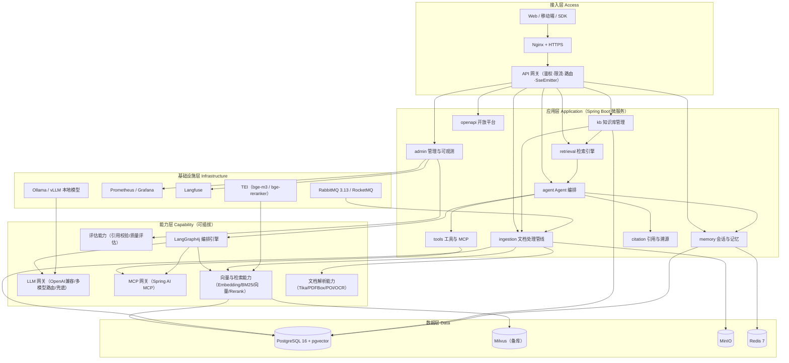
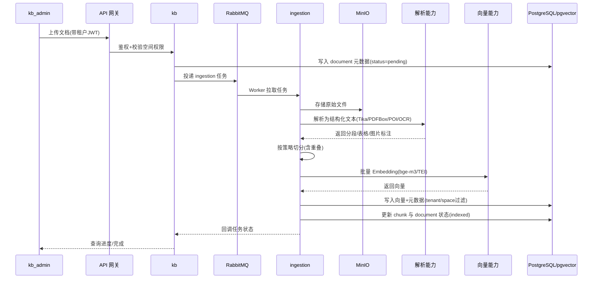
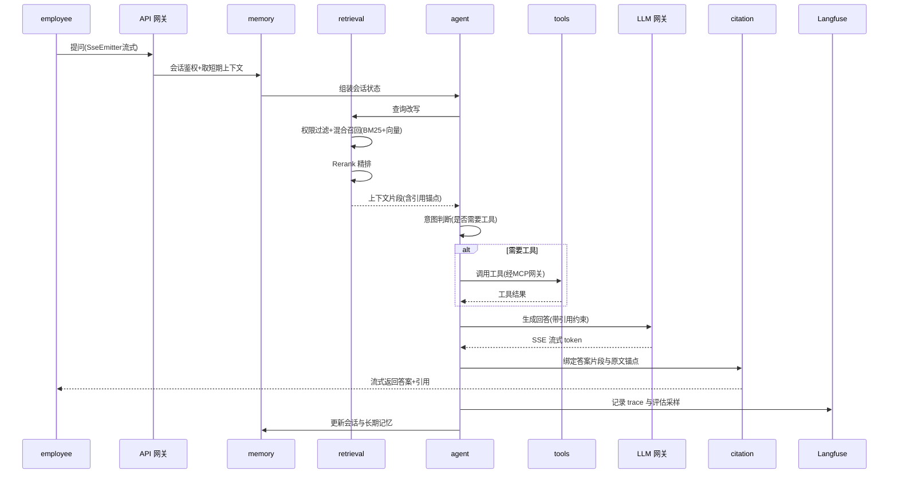
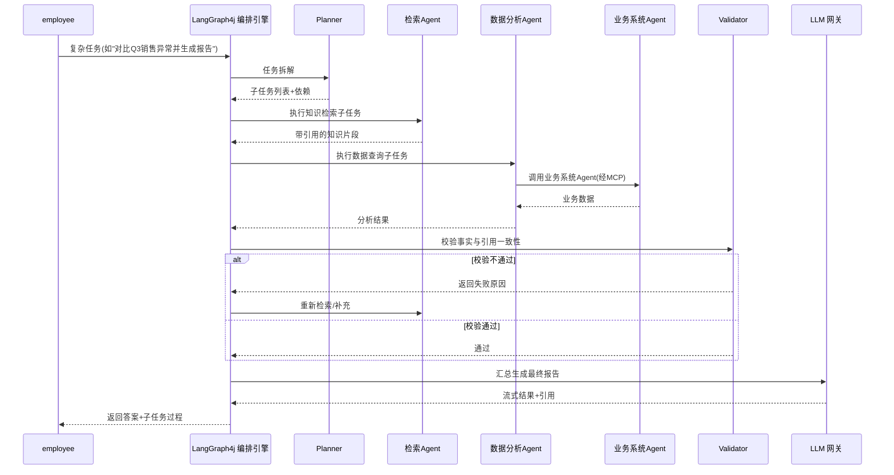
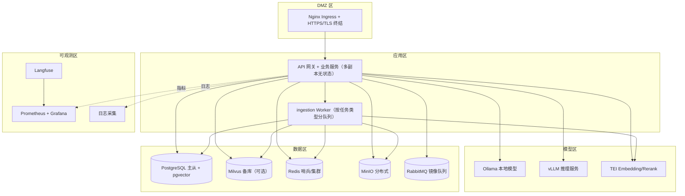

# 07 总体架构设计

> 文档元信息
>
> | 项 | 内容 |
> |---|---|
> | 文档名称 | 星枢 Nexus · 企业智能知识库与问答智能体平台 — 总体架构设计 |
> | 版本 | v0.3（Java 技术栈，一致性修订） |
> | 作者 | AI 助手 |
> | 状态 | 基线 |
> | 日期 | 2026-10-29 |
> | 阶段归属 | Phase 2 设计阶段 |
> | 上游基线 | [项目基线与统一约定](../00-项目基线/项目基线与统一约定.md) |

---

## 1. 架构设计目标与原则

### 1.1 设计目标

总体架构服务于「星枢 Nexus（NKAP）」作为**面向 B 端企业客户的私有化 / 混合部署 AI 知识平台**的定位，须同时满足：**功能闭环**（知识入库 → 混合检索 → Agent 编排 → 带引用流式问答 → 审计评估）、**私有化可交付**（模型/向量库/对象存储可内网离线运行）、**多租户可控**（以租户为隔离边界，权限贯穿检索/组装/生成/引用全链路）、**可持续演进**（MVP 到生产的组件替换不改变模块边界）。

### 1.2 设计原则

| 原则 | 说明 | 落地体现 |
|---|---|---|
| 高内聚低耦合 | 模块按业务域聚合，跨域只通过契约接口通信 | `kb`/`ingestion`/`retrieval`/`agent`/`tools`/`memory`/`citation`/`admin`/`openapi` 九大模块，互不直连表 |
| 私有化优先 | 核心模型与数据可完全离线部署 | Ollama / vLLM 兜底 + Embedding/Reranker 本地推理 + pgvector / MinIO 内网部署 |
| 协议解耦 | 适配层屏蔽上游差异 | OpenAI 兼容层接 LLM；向量库/Embedding/Reranker 可插拔；MCP 统一工具接入 |
| 编排优于提示 | 复杂任务显式建模为状态图 | LangGraph4j 承载意图路由、条件分支、循环、人工审批 |
| 可观测可评估 | 每次 LLM 调用可追溯，每个 RAG 结果有分数 | Langfuse Trace + Micrometer/Prometheus 指标 + `admin` 评估审计 |
| 最小可运行 | MVP 允许降级跑通闭环再逐步替换 | MVP：pgvector + DeepSeek + bge-m3；V1/V2 逐步扩展 |

### 1.3 架构质量目标

| 维度 | 目标 |
|---|---|
| 可用性 | 生产核心链路 99.9%，单可用区故障不影响问答 |
| 延迟 | 首 token（TTFT）P95 ≤ 3s / P99 ≤ 5s；端到端流式（E2E）P95 ≤ 15s / P99 ≤ 25s（不含工具调用，与 06 NFR-001/002 口径一致） |
| 扩展性 | 检索与问答服务无状态水平扩展；pgvector 支持分区与只读副本 |
| 安全合规 | 权限过滤在检索层强制生效；问答全留痕可审计 |
| 成本 | 单租户最小部署 ≤ 8 vCPU / 32GB（本地模型场景可上调） |

---

## 2. 总体架构图

> 实线为同步调用或数据读写；各层内部组件严格按基线模块命名。

---

## 3. 分层职责说明

### 3.1 接入层

| 组件 | 职责 |
|---|---|
| Nginx + HTTPS | 统一入口，TLS 终结，静态资源分发，反向代理，SSE/WebSocket 长连接保活 |
| API 网关 | OIDC/JWT/API Key 鉴权、租户解析、限流熔断、路由、审计、配额 |
| SseEmitter 通道 | 承载问答流式输出，与 WebSocket 按场景并存 |

### 3.2 应用层（Spring Boot 微服务划分）

应用层是**业务能力的编排者**。每个模块以独立 Spring Boot 3 服务部署（MVP 阶段可合并为单体多模块，V1 拆分），对应基线统一命名：

| 模块 | 标识 | 职责 |
|---|---|---|
| 知识库管理 | `kb` | 空间、文档版本、标签、切分策略、空间级权限 |
| 文档处理管线 | `ingestion` | 上传→解析→切分→向量化→混合索引→元数据入库，全异步 |
| 检索引擎 | `retrieval` | 查询改写、权限过滤检索、混合召回、Rerank、上下文组装 |
| Agent 编排 | `agent` | 意图路由、工具调用决策、多智能体协同、人工审批 |
| 工具与 MCP | `tools` | 内置工具注册表 + MCP Server 接入、鉴权与结果回传 |
| 会话与记忆 | `memory` | 短期会话、长期记忆、上下文压缩、会话检索 |
| 引用与溯源 | `citation` | 答案片段级引用绑定、原文跳转、可验证性校验 |
| 管理与可观测 | `admin` | 评估、审计、指标、配额计费、模型/向量库配置 |
| 开放平台 | `openapi` | API Key、配额、Webhook、开放接口版本管理 |

### 3.3 能力层

能力层是**可插拔的通用 AI 能力**，向上提供稳定抽象、向下屏蔽实现：

| 组件 | 职责 |
|---|---|
| LLM 网关 | OpenAI 兼容接入、多模型路由、主备降级、Token 计量限流 |
| LangGraph4j 编排引擎 | 状态图执行路由、分支、循环、人工审批、检查点回放 |
| MCP 网关 | 工具发现、Schema 校验、调用鉴权、超时隔离、脱敏 |
| 向量与检索能力 | Embedding 推理、BM25 稀疏召回、向量稠密召回、融合与 Rerank |
| 文档解析能力 | PDF/Word/Excel/PPT/图片/HTML 解析、OCR、版面还原 |
| 评估能力 | 引用准确率、无依据回答率、召回率等离线与在线评估 |

### 3.4 数据层与基础设施层

| 存储/组件 | 用途 | 说明 |
|---|---|---|
| PostgreSQL 16 + pgvector | 元数据、权限、会话、审计、引用关系、向量 | 向量与业务数据同库，强一致 |
| Milvus | 备选向量库 | 超大规模或复杂检索场景可切换 |
| MinIO | 原始文档与中间产物 | S3 兼容 |
| Redis 7 | 缓存、限流、会话短期状态 | 允许重建 |
| RabbitMQ 3.13 / RocketMQ | 异步文档处理、领域事件 | 主选 RabbitMQ，高吞吐备选 RocketMQ |
| Spring Batch / Quartz | 批量入库、定时任务 | 与 MQ 解耦的批处理与调度 |
| Prometheus/Grafana/Langfuse | 指标/可视化/LLM Trace | 可观测 |
| TEI / Ollama / vLLM | Embedding、Rerank、本地 LLM 推理 | 私有化模型服务 |
| Kubernetes / Docker Compose | 生产编排 / 开发编排 | 声明式运维 |

**模块边界与依赖规则**：依赖单向——`agent` 依赖 `retrieval`/`tools`/`memory`/`citation`，下游模块不得反向依赖 `agent`，`ingestion` 只被 `kb` 触发；数据所有权上每个模块独占自己的表集合，跨域通过服务接口或领域事件（RabbitMQ）交互，禁止跨域直连表；契约优先——跨模块接口以 OpenAPI 3.1 契约先行，服务间用 REST（同步）或 RabbitMQ（异步），避免点对点耦合。

## 4. 核心组件说明

| 组件 | 定位 | 关键能力 | 设计要点 |
|---|---|---|---|
| API 网关 | 接入层与应用层之间唯一入口 | OIDC/JWT/API Key 鉴权、租户解析、令牌桶限流、熔断、审计、路由 | 只做认证与流量治理，业务权限由 `kb`/`retrieval` 二次校验，纵深防御 |
| WebFlux 运行时 | 全链路非阻塞运行时 | 高并发问答、逐 token 流式返回、背压控制、R2DBC/Redis 响应式衔接 | 以 `WebFlux SseEmitter` 解耦 LLM 流式与 SSE；CPU 密集任务下沉异步 |
| RabbitMQ 异步任务 | `ingestion` 全链路异步载体 | 文档解析、切分向量化、索引重建、全量回溯、评估批跑、记忆压缩 | 任务幂等（`document_id + chunk_index`）；分片并行；失败重试与 DLQ；按任务类型拆队列 |
| pgvector 向量库 | 主向量库 | 向量与元数据同库、HNSW/IVFFlat 索引、租户/空间过滤 | 权限过滤在 SQL 层一次完成；统一 Provider 接口屏蔽 pgvector/Milvus 差异 |
| LLM 网关 | 模型统一入口 | OpenAI 兼容、多模型路由、降级重试、Token 配额、并发限流、结构化输出 | 模型选择对 Agent 透明；所有调用产生 Langfuse Trace |
| LangGraph4j 编排引擎 | Agent 编排载体 | 状态图路由、工具循环、多智能体协同、人工审批挂起/恢复 | 显式节点/条件边/检查点，可回放可审计；不通过提示词堆叠实现复杂流程 |
| MCP 网关 | 工具与外部数据源接入层 | MCP Server 注册发现、Schema 校验、鉴权隔离、超时裁剪、脱敏 | 基于 Spring AI MCP；内置工具亦注册为 MCP 工具，调用路径一致 |
| 可观测 | Trace/指标/日志/评估 | Langfuse Trace、Micrometer 指标、结构化日志、在线离线评估 | 全链路含 `tenant_id`/`conversation_id`/`trace_id`；`admin` 产出引用准确率与无依据回答率 |

## 5. 关键数据流

### 5.1 知识入库流

### 5.2 智能问答流

### 5.3 多智能体协同流

> 权限与审计旁路：所有数据流携带 `tenant_id`，检索层在召回阶段即应用权限过滤，确保越权原文不进入上下文；审计覆盖上传/变更、检索、工具调用、问答与引用跳转。

---

## 6. 部署架构

### 6.1 开发环境（Docker Compose）

单机以 Docker Compose 编排全栈：`Nginx` → `spring-boot 微服务` / `web 前端`；`ingestion-worker` 消费 RabbitMQ 队列，写入 PostgreSQL/pgvector，原始文件落 MinIO，Embedding/Rerank 走 TEI，本地 LLM 走 Ollama。MVP 允许仅用 pgvector + Ollama；配置经 `.env` / 环境变量注入。

### 6.2 生产环境（Kubernetes）

### 6.3 网络分区与关键项

| 分区 | 暴露范围 | 承载 |
|---|---|---|
| DMZ 区 | 仅 443 对外 | Nginx Ingress、TLS 终结、限流 |
| 应用区 | 内网 | API 网关、业务服务、ingestion Worker |
| 模型区 | 内网 | Ollama、vLLM、TEI |
| 数据区 | 内网 | PostgreSQL、Milvus、Redis、RabbitMQ、MinIO |
| 可观测区 | 内网 | Prometheus、Grafana、Langfuse、日志 |

- **Nginx**：TLS 终结、静态资源、反向代理、SSE/WebSocket 长连接保活（`proxy_read_timeout` 调优）。
- **HTTPS**：启用 TLS 1.2+，企业内网建议 mTLS，证书由内部 CA 签发并自动轮换。
- **模型服务**：推理服务独立调度，仅应用区可访问，模型区与数据区网络隔离。
- **存储**：PostgreSQL 主从读写分离；pgvector 随库分区与只读副本；Milvus 分片 + 副本；MinIO 多副本 + 备份；Redis 哨兵/集群。
- **配置与密钥**：Secret/ConfigMap 或密钥管理服务注入，禁止明文入库。

## 7. 高可用与扩展性设计

**水平扩展**：应用层服务（API 网关、业务服务、Agent 编排）**无状态**，K8s HPA 按 CPU/QPS 自动扩缩容；`ingestion` Worker 按任务类型（解析、向量、索引）拆队列独立扩缩容；RabbitMQ 采用镜像队列/仲裁队列，RocketMQ 场景使用 Dledger 多副本。

**读写分离与缓存**：PostgreSQL 主写从读，元数据查询与 pgvector 只读检索走只读副本；Redis 承载空间元数据、切分配置、会话上下文、限流计数、Embedding 结果等热点，采用「租户 + 对象 + 版本」三级 key 并主动失效。

**限流熔断**：网关层按租户/API Key 令牌桶限流；LLM 网关按模型并发与 Token 限流，超阈值排队或降级备选模型；向量库、LLM、MCP 工具配置超时与熔断（Resilience4j / Sentinel），故障时返回可解释降级结果（如检索摘要）而非 500。

**容量规划**：

| 指标 | 估算口径 | 说明 |
|---|---|---|
| 文档量 | 首期 ≥ 1000 份 | 单份平均 20 页 ≈ 50 chunks |
| 向量规模 | 5 万 ~ 50 万向量 | 1000 份 × 500 chunks 上限 |
| 存储 | 原始 ~50GB + 向量 ~100GB + 中间产物 ~30GB | MinIO + PostgreSQL/pgvector |
| 并发 | 单租户 50 QPS，峰值 200 QPS | HPA 扩容 |
| 模型 | DeepSeek 主力 + Qwen 备选 + Ollama/vLLM 兜底 | 本地 1 实例起步 |

**容灾与备份**：PostgreSQL 每日全备 + WAL 归档（RPO ≤ 5 分钟，pgvector 随库备份）；Milvus 快照 + 副本可切换；MinIO 多副本 + 版本化；Redis 可重建不承载唯一数据；多可用区跨区异步复制，RTO ≤ 30 分钟。

## 8. 架构决策记录（ADR）

### ADR-001 为何选 LangGraph4j 而非纯提示编排
**背景**：问答需意图路由、工具循环、多智能体协同与人工审批，存在分支与回溯。**决策**：采用 LangGraph4j 状态图显式建模节点、条件边、循环与检查点。**理由**：可回放、可测试、可审计，契合人工审批与失败重试，避免提示词堆叠的不可维护性，且与 Spring AI 的模型/工具抽象天然兼容。**代价**：学习与调试门槛高于链式调用，简单问答场景略显重。**替代方案**：纯 LangChain4j Chain（难分支）；自研状态机（成本高、生态弱）；Spring AI Alibaba Agent Framework（偏高层，定制受限）。

### ADR-002 为何选 pgvector 为主向量库
**背景**：企业文档规模中等（首期 5 万~50 万向量），要求多租户过滤、与业务元数据强一致、私有化运维简单。**决策**：PostgreSQL 16 + pgvector 0.5+ 为主向量库，Milvus 为备选。**理由**：向量与业务数据同库，权限过滤在 SQL 层一次完成，事务一致；运维仅需一套 PostgreSQL；MVP 与生产边界一致，切换成本最低。**代价**：超大规模（千万级）与高并发纯向量检索性能不如专用向量库；HNSW 索引内存占用需规划。**替代方案**：Milvus（组件多、运维重，超大规模备选）；Qdrant（功能优但引入独立组件）；Elasticsearch（许可与资源开销）。

### ADR-003 为何采用 Lucene BM25 + 向量混合检索
**背景**：企业文档含大量专有名词、编号、型号，纯向量易漏精确匹配。**决策**：稀疏（Lucene BM25 / pg_search）+ 稠密（pgvector 向量）双通道召回后融合（RRF），再经 bge-reranker 精排。**理由**：提升精确术语与长尾问题召回率；Rerank 修正融合排序偏差，支撑「引用准确率 ≥ 90%」。**代价**：链路复杂、延迟与算力上升；需维护融合权重与评估基线。**替代方案**：纯向量（精确匹配弱）；多路召回（V2 扩展，成本更高）。

### ADR-004 为何用 MCP 统一工具接入
**背景**：业务系统工具异构、接口不统一，AI 调用真实数据成本高。**决策**：通过 MCP 网关（Spring AI MCP）统一工具与数据源接入，内置工具亦注册为 MCP 工具。**理由**：标准化工具发现与调用协议，降低接入成本；统一鉴权、限流、审计、脱敏；具生态前瞻性。**代价**：MCP 生态仍在演进，部分能力需补齐（如版本治理）；调试链路较长。**替代方案**：逐类定制 Function Calling（重复建设）；自研工具市场（生态封闭）。

### ADR-005 为何私有化小模型兜底
**背景**：部分客户要求数据不出内网，或公有模型服务不可用。**决策**：主力 DeepSeek-V3 / Qwen2.5，同时部署 Ollama / vLLM 本地模型兜底，保障可用性与合规。**理由**：满足私有化合规；外部模型故障或网络隔离时仍可提供基础问答；模型路由对上层透明。**代价**：本地小模型质量与速度下降，体验受损；承担本地算力与模型管理成本。**替代方案**：强制公有云（合规风险）；仅用本地大模型（成本与效果难兼顾）。

### ADR-006 为何异步化文档入库
**背景**：解析与向量化耗时长，同步请求易超时并占用资源。**决策**：`ingestion` 全链路异步化，RabbitMQ + Spring AMQP 驱动，任务幂等可追踪，DLQ 兜底。**理由**：提升上传吞吐与体验；支持批量回溯与失败重试；Worker 独立扩缩容。**代价**：架构复杂度上升，需处理队列积压、状态机与最终一致性。**替代方案**：同步入库（超时风险高）；自研调度（重复建设）。

### ADR-007 为何检索层强制权限过滤
**背景**：知识库涉及多空间权限，AI 越权引用即构成合规事故。**决策**：召回阶段即应用 `tenant_id` + 空间权限过滤，上下文组装前二次校验引用可见性。**理由**：从源头阻断越权内容进入上下文与答案，满足「谁能问、能问什么、能看到哪段原文」要求。**代价**：过滤逻辑下沉检索链路，增加复杂度与性能开销；需与权限变更实时一致。**替代方案**：生成后过滤（易漏）；仅靠提示词约束（不可靠）。

## 9. 变更记录

| 日期 | 版本 | 变更内容 | 变更人 |
|---|---|---|---|
| 2026-10-29 | v0.1 | 初始基线（Python 技术栈）：总体架构、分层职责、核心组件、数据流、部署、高可用、ADR | AI 助手 |
| 2026-10-29 | v0.2 | 技术栈切换为 Java 生态：WebFlux/SseEmitter、RabbitMQ、pgvector、LangGraph4j、Spring AI MCP、TEI；模块命名与角色术语不变 | AI 助手 |
| 2026-10-29 | v0.3 | 一致性修订：将 §1.3 架构延迟目标与 06《非功能性需求》NFR-001/002 对齐（原「首 token ≤1.5s、端到端 ≤8s」与 01/04/06 的「首 token ≤3s、端到端 ≤15s」冲突），统一为 TTFT P95≤3s/P99≤5s、E2E P95≤15s/P99≤25s | AI 助手 |
| 2026-10-29 | v0.3 | 项目更名：原「知行 ZhiXing / ZX-KAP」正式更名为「星枢 Nexus / NKAP」；工作目录由 新建文件夹 更名为 nexus（D:\homework\projects\nexus） | AI 助手 |

---

## 关联文档

- [项目基线与统一约定](../00-项目基线/项目基线与统一约定.md)
- [04-需求规格说明书](../02-需求分析/04-需求规格说明书.md)
- [06-非功能性需求与数据规则](../02-需求分析/06-非功能性需求与数据规则.md)
- [09-详细设计-RAG与Agent](./09-详细设计-RAG与Agent.md)
- [10-数据库设计](./10-数据库设计.md)
- [11-接口设计](./11-接口设计.md)
- [08-技术选型与方案论证](./08-技术选型与方案论证.md)
