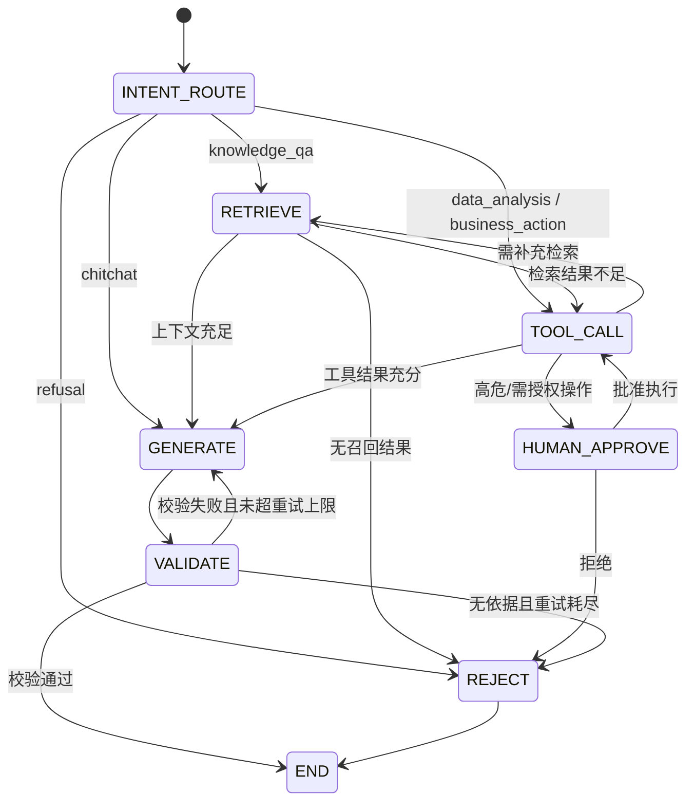

# 详细设计 · RAG 与 Agent

## 文档元信息

| 项 | 内容 |
|---|---|
| 文档编号 | NKAP-DESIGN-09 |
| 版本 | v0.2 |
| 作者 | AI 助手 |
| 状态 | 基线 |
| 日期 | 2026-10-29 |
| 所属模块 | `kb` / `ingestion` / `retrieval` / `agent` / `tools` / `memory` / `citation` / `admin` |
| 基线依据 | [项目基线与统一约定](../00-项目基线/项目基线与统一约定.md) |
| 技术栈 | Java 21 + Spring Boot 3.2+ + Spring WebFlux + Spring Security 6 + LangGraph4j + Spring AI 1.0 + LangChain4j + OpenAI 兼容接口 + PostgreSQL 16/pgvector + Lucene BM25 + bge-reranker + bge-m3 + Apache Tika/PDFBox/POI + Redis + RabbitMQ + MinIO + SseEmitter + MCP + Langfuse |
| 优先级标注 | 本设计条目以 **MVP / V1 / V2** 标注阶段归属 |

### 变更记录

| 日期 | 版本 | 变更内容 | 变更人 |
|---|---|---|---|
| 2026-10-29 | v0.1 | 初始基线（Python 栈）：RAG 管线、检索引擎、Agent 编排、记忆、引用、幻觉抑制、MCP、埋点 | AI 助手 |
| 2026-10-29 | v0.2 | 按基线 v0.2 全面切换为 **Java 生态**：FastAPI→Spring WebFlux、Celery→RabbitMQ+Spring Batch、Qdrant→pgvector、rank_bm25→Lucene BM25、Unstructured→Apache Tika/PDFBox/POI、LangGraph→LangGraph4j、LangChain→Spring AI/LangChain4j、Alembic→Flyway；模块划分、角色、术语、切分参数与 Top-K 等设计结论不变 | AI 助手 |
| 2026-10-29 | v0.2 | 项目更名：原「知行 ZhiXing / ZX-KAP」正式更名为「星枢 Nexus / NKAP」；工作目录由 新建文件夹 更名为 nexus（D:\homework\projects\nexus） | AI 助手 |

---

## 1. 概述

本文档定义 NKAP 的两条核心链路：**知识入库流**（`ingestion`）与**智能问答流**（`retrieval` + `agent` + `memory` + `citation`），并给出质量保障与 MCP 工具接入的设计规格。设计遵循基线中「编排优于提示」「可观测可评估」「私有化优先」三条原则。

核心设计结论：

1. 入库采用 **RabbitMQ 异步任务 + 版本化**，文档以 `content_hash` 去重，失败进入死信队列（Dead Letter Queue, DLQ）可人工重放。
2. 检索采用 **Lucene BM25 + pgvector 向量双通道召回、RRF 融合、Rerank 精排**，权限过滤在召回前以 SQL/Filter 谓词强制注入，形成「权限优先」的检索链路。
3. Agent 采用 **LangGraph4j 状态图**显式建模，`RETRIEVE` / `TOOL_CALL` / `GENERATE` / `VALIDATE` 四类节点可循环、可条件跳转、可挂起等待人工审批。
4. 引用采用**片段级引用 ID**，答案每个事实句绑定可跳转原文，引用校验失败触发拒答或重生成。

---

## 2. 文档处理管线详细设计（`ingestion`）

### 2.1 总体流程

```
上传 → 解析 → 切分 → 向量化 → 混合索引 → 元数据入库 → 可检索
```

管线以 **RabbitMQ（Spring AMQP）+ Spring Batch/Quartz** 驱动，每阶段落库并写 `task_job`，支持断点续跑与失败重试。`ingestion` 模块内部以 `IngestionPipeline` 编排，各阶段为可插拔 `StageHandler`。

| 阶段 | 服务/组件 | 阶段标识 | 产物 |
|---|---|---|---|
| 上传接收 | Spring WebFlux（`FilePart`）+ MinIO Java Client | `upload` | MinIO 原始对象、`document` 记录 |
| 解析 | Apache Tika + PDFBox + POI + Tesseract/PaddleOCR | `parse` | 结构化文本（Markdown） |
| 切分 | `ChunkingService`（自研切分器） | `chunk` | `chunk` 记录 |
| 向量化 | bge-m3（TEI 本地 / 远端 HTTP，LangChain4j 适配） | `embed` | 向量（`embedding` 列） |
| 索引 | pgvector + Lucene BM25 本地倒排 | `index` | 向量 + 稀疏倒排 |
| 元数据入库 | Spring Data JPA + Flyway | `persist` | 可检索状态 |

### 2.2 上传（Upload）

- 接收方式：Spring WebFlux 非阻塞 `multipart/form-data` 分片上传，最大单文件 200 MB（MVP 可调）。
- 原始文件落 MinIO，对象键格式：`tenant/{tenant_id}/space/{space_id}/doc/{document_id}/raw/{filename}`。
- 上传完成生成 `document_version`（初始版本 `v1`），记录 `content_hash`（SHA-256）。
- 病毒扫描：接入 ClamAV 扫描原始文件，阳性则标记 `quarantined`。
- 断点续传：以 `upload_id` + `part_number` 记录分片，合并后校验 `content_hash`。
- 幂等：`Idempotency-Key` 保证同一文件重复上传不产生重复记录。

### 2.3 解析（Parse）

| 格式 | 解析器 | 备注 |
|---|---|---|
| `.pdf` | Apache PDFBox（正文）+ Tesseract（扫描页 OCR） | 保留章节结构与页码 |
| `.docx` / `.doc` | Apache POI（XWPF/HWPF） | 保留标题层级 |
| `.xlsx` / `.xls` | Apache POI（XSSF/HSSF） | 每 sheet 转表格文本 |
| `.pptx` | Apache POI（XSLF） | 每页为一区块 |
| `.html` / `.md` / `.txt` | Apache Tika | 去除脚本与样式 |
| 图片 `.png` / `.jpg` | Tesseract / PaddleOCR | OCR 文本 |

解析产出统一为 **Markdown 结构化文本**，保留标题（`#`）、表格、图片占位（``），并输出 `toc`（目录层级）供切分使用。解析能力统一由 `DocumentParser` 接口抽象，新增格式只需扩展实现。

### 2.4 切分（Chunk）

| 参数 | 取值 | 说明 |
|---|---|---|
| `chunk_size` | 500 | 目标片段长度（字符） |
| `overlap` | 80 | 相邻片段重叠字符数 |
| `min_chunk_size` | 80 | 低于该长度的尾部片段合并到前块 |
| `max_chunk_size` | 650 | 超长段落硬切 |
| `separator` | `["\n## ", "\n### ", "\n\n", "\n", " "]` | 优先按标题层级，其次段落，最后按长度 |
| `keep_title_path` | true | 每个片段携带所属标题路径（`heading_path`） |
| `chunk_strategy` | `heading_aware` | 按标题层级切分 |

切分策略要点：

1. **标题优先**：先按标题层级（H1→H6）切出语义区块；区块超长再按 `chunk_size/overlap` 滑窗切分，避免跨标题硬切。
2. **元数据继承**：每个 `chunk` 继承文档的 `space_id`、`tenant_id`、标签与权限快照（`acl_tags`、`visibility`）。
3. **表格保护**：表格不被拆散，整表落在同一片段或按行截断时保留表头。
4. **图片描述**：图片占位符旁合并 OCR/Alt 文本，形成可检索上下文。

### 2.5 向量化（Embed）

- 模型：`bge-m3`（中英文，1024 维）；备选 `bge-large-zh`。
- 批大小：`batch_size=32`；单任务并发上限 4（由 Semaphore/令牌桶控制）。
- 输入：`chunk.text` + 可选 `heading_path` 前缀拼接，增强语义。
- 空文本、纯符号片段跳过并记录 `skipped` 原因。
- 向量写入 `chunk.embedding`（pgvector `vector(1024)`），与 `chunk.id` 一一对应，不单独建外部向量库点。

### 2.6 索引（Index）

- **稠密通道**：pgvector `chunk.embedding` 列，HNSW 索引（见 [10-数据库设计](10-数据库设计.md) §5）。
- **稀疏通道**：Lucene BM25，按 `tenant_id` 分片的本地倒排索引（Directory），写入 `chunk` 时同步更新。
- 向量检索点 ID 规范：以 `chunk.id` 为唯一标识；检索结果通过 `chunk_id` 与业务数据对齐。

### 2.7 增量更新与去重

- **文档级去重**：同一 `space_id` 内 `content_hash` 相同视为重复，仅保留最新版本，返回既有 `document_id`（返回 `duplicated=true`）。
- **增量更新**：同一文档新版本触发 `document_version` 追加，旧版本 `chunk` 标记 `superseded`，向量列回填后生效；检索以 `status='active'` + `is_current` 版本为准，实现版本切换。
- **删除语义**：软删除（`is_deleted`），向量列保留但状态置 `deleted`，检索时过滤。
- **增量触发**：MinIO 事件通知或显式 `reindex` 接口。

### 2.8 失败重试与死信（RabbitMQ）

| 项 | 规格 |
|---|---|
| 任务载体 | RabbitMQ 3.13 + Spring AMQP；批量任务用 Spring Batch，定时任务用 Quartz |
| 主队列 | `ingestion.pipeline.q`（按 `job_type` 路由） |
| 死信交换机/队列 | `ingestion.dlx` → `ingestion.dlq` |
| 死信配置 | 队列绑定 `x-dead-letter-exchange=ingestion.dlx`、`x-dead-letter-routing-key=ingestion.dlq` |
| 最大重试 | 5 次，指数退避 `2^n`（上限 300s） |
| 可重试异常 | 网络抖动、MinIO 临时错误、解析超时、LLM/Embedding 限流 |
| 不可重试异常 | 格式不支持、文件损坏、OCR 失败 → 直接 `failed` |
| 死信内容 | 完整任务体保留 `error`、`payload`、`attempt`、`trace_id` |
| 人工处理 | `admin` 控制台查看 DLQ，可「重放」或「放弃」 |
| 告警 | DLQ 长度 > 阈值触发 Prometheus alert |

`task_job` 记录 `attempt`、`last_error`、`status`、`exchange`、`routing_key`，保证可追溯。任务幂等键为 `document_id + chunk_seq`。

---

## 3. 检索引擎详细设计（`retrieval`）

### 3.1 查询改写（Query Rewriting）

由 `QueryRewriter`（Spring AI / LangChain4j）执行：

1. **口语化改写**：将口语问题改写为利于检索的标准问句（如「报销怎么弄」→「差旅费报销流程」）。
2. **子查询扩展**：对多意图问题拆解为 2–4 个子查询，并行检索后合并。
3. **同义词扩展**：基于业务词典扩展同义词（如「HR」→「人力资源」）。
4. **历史注入**：结合最近 2 轮对话补全指代（「它」→ 具体实体）。
5. **语言判定**：中英文分别选择对应 embedding 通道。

### 3.2 混合检索

| 通道 | 方法 | 组件 | 说明 |
|---|---|---|---|
| 稀疏通道 | Lucene BM25 | 本地倒排索引 | 关键词精确匹配，对专有名词、编号、术语敏感 |
| 稠密通道 | 向量余弦相似度 | pgvector | 语义召回，处理同义改写 |

两通道均在**同一权限过滤条件下**执行，召回 Top-K 候选（默认各 `top_k=50`）。检索结果统一封装为 `RetrievedChunk`（含 `chunk_id`、`score`、`channel`）。

### 3.3 RRF 融合算法

采用 Reciprocal Rank Fusion（倒数排名融合），对两通道结果按排名加权，避免分数尺度不一致：

```
RRF_score(d) = Σ_channel  1 / (k + rank_channel(d))      k = 60
final_score(d) = RRF_score(d) * (1 + α * rerank_boost)
```

| 参数 | 值 | 说明 |
|---|---|---|
| `k` | 60 | 平滑常数，经验值 |
| `alpha` | 0.5（MVP） | Rerank 增益权重 |
| 融合后候选 | Top-30 | 送入 Rerank |

### 3.4 权限过滤实现

权限过滤必须**在召回前注入**，避免越权文档进入候选集：

1. 从 `conversation` 上下文解析调用者身份、租户、空间、角色。
2. 从 `chunk` 读取 `tenant_id`、`space_id`、`acl_tags`、`visibility`。
3. 生成过滤条件：`tenant_id = current` AND（`space_id ∈ allowed_spaces` OR `visibility = public`）AND（`acl_tags` 与用户标签集合有交集 OR `acl_tags` 为空）。
4. 稠密通道将条件以 **SQL `WHERE` 谓词下推**（pgvector 支持属性过滤，过滤字段建 B-Tree 索引）；稀疏通道使用同一条件构造 **Lucene `BooleanQuery` Filter**。
5. 用户无 `space_id` 权限时该空间**完全不进入召回**，而非召回后裁剪。

### 3.5 Rerank 流程

- 模型：`bge-reranker`（TEI 本地 / 远端 API，LangChain4j 适配）。
- 输入：`query` + `chunk.text`，输出相关性分数 `[0,1]`。
- 精排后取 Top-10 送入上下文组装。
- 对 Rerank 分数低于 `min_relevance`（默认 0.35）的结果直接丢弃。

### 3.6 Top-K 配置

| 阶段 | K | 说明 |
|---|---|---|
| 单通道召回 | 50 | BM25 / 向量各自 |
| RRF 融合 | 30 | 融合后候选 |
| Rerank 精排 | 10 | 最终进入上下文 |
| 上下文字符预算 | 8000 | 超预算按 Rerank 分数截断 |

### 3.7 上下文组装

由 `ContextAssembler` 在 Token 预算内组装，顺序如下：

1. 系统指令（含引用约束、拒答规则）。
2. 检索片段（每段含 `citation_id`、`heading_path`、`text`、`score`）。
3. 会话摘要（短期记忆压缩）。
4. 工具返回结果（如已调用）。
5. 当前用户提问。

每个检索片段以 `[C1] [C2]` 形式标注引用 ID，供生成阶段绑定。

---

## 4. Agent 编排详细设计（`agent`）

### 4.1 意图路由规则

| 意图 | 判定条件 | 路由目标 |
|---|---|---|
| `knowledge_qa` | 问题命中知识库语义且非工具型 | `RETRIEVE` |
| `data_analysis` | 含统计/对比/图表诉求或命中数据分析工具 | `TOOL_CALL` |
| `business_action` | 需调用业务系统（工单、审批等） | `TOOL_CALL` → 可能 `HUMAN_APPROVE` |
| `chitchat` | 问候/闲聊，无知识诉求 | `GENERATE` |
| `refusal` | 命中合规/越权/无依据 | `REJECT` |

路由由轻量分类器 + 规则触发，结果写入 `state.intent`。

### 4.2 LangGraph4j 状态图



### 4.3 节点说明

| 节点 | 输入 | 处理 | 输出 |
|---|---|---|---|
| `INTENT_ROUTE` | 用户消息、会话摘要 | 意图分类 | `intent` |
| `RETRIEVE` | `intent`、查询改写结果 | 混合检索 + Rerank + 权限过滤 | `chunks`、`citations` |
| `TOOL_CALL` | 检索结果、工具参数 | Spring AI Function Calling / MCP 调用 | `tool_result`、`tool_trace` |
| `GENERATE` | 上下文、引用标注 | Spring AI `ChatClient` 流式生成 | `draft_answer`、`citations` |
| `VALIDATE` | 草稿、引用、检索集 | 引用校验 + 自我校验 | `validated` / `need_retry` |
| `HUMAN_APPROVE` | 高危操作请求 | 挂起等待人工确认 | `approved` / `denied` |

### 4.4 条件边、循环与检查点

- 图由 LangGraph4j `StateGraph<AgentState>` 构建，节点为 `NodeAction<AgentState>`，条件边为 `ConditionalEdgeAction`，编译为 `CompiledGraph`。
- 检查点（Checkpointer）：基于 Redis 的 saver，实现状态持久化、回放与审计；人工审批使用 `interrupt()` 挂起、`resume()` 恢复。
- 条件边由 `route_after_<node>()` 决定，返回下一节点名。
- 循环保护：`GENERATE → VALIDATE → GENERATE` 最多 2 次；`TOOL_CALL → RETRIEVE` 最多 3 次，防止死循环。
- 每次循环写入 `state.loop_count` 与 `state.trace`。

### 4.5 人工审批

- 触发：`tool_grant.requires_approval = true` 且调用者无该工具的 `auto_approve` 权限。
- 流程：`TOOL_CALL` 挂起 → 返回 `pending_approval` 事件 → 前端展示审批卡 → 审批通过后从 `HUMAN_APPROVE` 恢复执行。
- 超时：审批等待上限 `APPROVAL_TTL`（默认 30 min），超时自动 `denied`。
- 高危操作必须双人复核（admin 指定审批人）。

### 4.6 工具调用流程

1. 模型基于上下文判断是否需调用工具（Spring AI Function Calling / MCP）。
2. 工具参数由模型生成，经 JSON Schema 校验（`ToolCallback` / `ToolSpecification`）。
3. 权限检查：调用者须持有 `tool_grant`（用户或角色级）。
4. 执行：内置工具本地执行；MCP 工具经 Spring AI MCP Client 转发。
5. 结果回写 `state.tool_result`，附带 `tool_call_id`、耗时、错误码。
6. 结果作为新上下文追加，进入下一轮生成。

### 4.7 Planner-Worker-Validator 协同

| 角色 | 职责 | 产出 |
|---|---|---|
| `Planner` | 拆解复杂任务为子任务 DAG | `plan`（子任务列表） |
| `Worker` | 执行子任务（检索/数据分析/工具调用） | `sub_result` |
| `Validator` | 校验子结果与最终答案的完整性/依据性 | `validation_report` |

- 路由：可分派至 `检索Agent`、`数据分析Agent`、`业务系统Agent`。
- 汇总：`Planner` 合并各 `Worker` 结果，交由 `Validator` 校验后生成最终答案。
- 失败处理：子任务失败重试 1 次，仍失败则降级回答并标注置信度。

---

## 5. 记忆与上下文工程（`memory`）

### 5.1 短期会话存储

- 载体：Redis（会话热数据，Redisson/Spring Cache）+ PostgreSQL `conversation`/`message`（持久化）。
- 内容：当前会话消息序列、检索缓存、工具调用历史。
- TTL：Redis 会话缓存 24h，惰性刷新。
- 上限：单会话最近 20 条消息入上下文。

### 5.2 长期记忆提取

- 触发：会话结束或每 N 轮，由 LLM 抽取「用户偏好」「历史结论」「待办」。
- 存储：`memory` 表，类型 `preference` / `fact` / `todo`。
- 写入前去重与冲突合并，避免记忆膨胀。
- 读取：按 `tenant_id + user_id` 检索，注入上下文（上限 5 条）。

### 5.3 上下文压缩策略

| 策略 | 说明 |
|---|---|
| 滑动窗口 | 仅保留最近 N 轮全文 |
| 摘要压缩 | 早期轮次压缩为 200 字摘要 |
| 去重合并 | 相同检索片段合并计数 |
| 预算裁剪 | 超 Token 预算按优先级裁剪（指令 > 片段 > 记忆） |

### 5.4 Token 预算管理

| 项 | 预算 |
|---|---|
| 系统指令 | 800 tokens |
| 检索上下文 | 8000 tokens |
| 会话摘要 | 1000 tokens |
| 记忆 | 1000 tokens |
| 输出预留 | 2000 tokens |
| 总量上限 | 128k（按模型上下文），超过触发压缩 |

---

## 6. 引用溯源设计（`citation`）

### 6.1 引用 ID 生成

- 格式：`C{chunk_id}`（如 `C8f3a...`），在检索阶段由 `chunk_id` 生成。
- 一个 `chunk` 可被多处引用，同一 `citation_id` 不重复生成。

### 6.2 片段级引用

- 引用粒度：片段（chunk）级，答案按句/事实块绑定 `citation_id`。
- `message_citation` 记录：`message_id`、`citation_id`、`chunk_id`、`document_id`、`space_id`、`score`、`snippet`。
- `citation_snippet` 记录原文片段的 `char_start`、`char_end`，支撑答案与原文的**逐句对齐校验**与前端高亮跳转。
- 前端展示「引用角标」，点击跳转原文片段并高亮。

### 6.3 答案与原文对齐校验

- 校验方式：NLI（自然语言推理，LangChain4j 模型适配）判断答案句子是否被引用片段支撑。
- 通过条件：`support_score >= 0.5` 且覆盖每个事实句。
- 未通过的句子标记 `unsupported`，触发重生成或从答案中剔除。

### 6.4 引用校验失败处理

| 场景 | 处理 |
|---|---|
| 部分句子无依据 | 剔除无依据句子，保留有依据部分 |
| 全部句子无依据 | 触发拒答（`REJECT`），返回「未找到可靠依据」 |
| 引用指向已删除/越权文档 | 移除该引用，标记 `citation_invalid` |
| 反复校验失败 | 记录 `eval_record`，转人工复核 |

---

## 7. 幻觉抑制与质量保障

### 7.1 无依据回答抑制

- 检索结果为空或全部低于阈值时，禁止生成，直接拒答。
- 生成阶段强约束：答案必须基于 `[Cx]` 片段，禁止引入片段外事实。
- 事实性关键词（数字、日期、人名、金额）必须能在引用片段中定位。

### 7.2 拒答策略

| 场景 | 策略 |
|---|---|
| 无相关知识 | 「知识库中未找到相关内容，请补充或联系管理员」 |
| 越权 | 「该内容不在您的权限范围内」 |
| 合规风险 | 按合规策略拒答并记录审计 |
| 模型不确定 | 明确说明不确定，不编造 |

### 7.3 自我校验

- 生成后由校验模型对答案做「依据性 / 一致性 / 完整性」三维评分。
- 任一维度低于阈值触发一次重生成（携带校验反馈）。

### 7.4 评估流水线

| 维度 | 指标 | 目标 |
|---|---|---|
| 引用准确率 | 有依据句子占比 | ≥ 90% |
| 无依据回答率 | 无依据答案占比 | ≤ 5% |
| 检索召回 | Recall@10 | ≥ 85% |
| 答案忠实度 | Faithfulness | ≥ 0.85 |

- 离线评估：标注问答对 + Langfuse 离线评估 + 自研评估器，Spring Batch 每日定时跑批。
- 在线评估：关键埋点采样（见第 9 节），生成 `eval_record`。
- 回归门禁：评估指标低于阈值阻断上线。

---

## 8. MCP 工具接入设计（`tools`）

### 8.1 MCP Server 注册

- 注册信息：`name`、`endpoint`（stdio / HTTP）、`version`、`auth_type`、`owner`。
- 生命周期：`registered → enabled → disabled → unregistered`。
- 健康检查：Spring AI MCP Client 周期心跳，失败自动 `disabled` 并告警。

### 8.2 工具发现

- 通过 MCP `tools/list` 拉取工具清单，缓存 5 min（Redis）。
- 每个工具生成 JSON Schema（名称、描述、参数、返回），同步至 `tool` 表。
- 工具描述用于 Function Calling 的可调用描述。

### 8.3 鉴权

| 方式 | 说明 |
|---|---|
| MCP Server 侧 | `Bearer` Token / mTLS，由部署侧配置 |
| 平台侧 | 调用者须具备 `tool_grant`，按角色/用户授权 |
| 敏感参数 | 入参中的密钥字段加密，不落审计明文 |

### 8.4 调用协议

1. 客户端发起 `tools/call`，携带 `name`、`arguments`。
2. 平台校验权限与配额后，经 Spring AI MCP Client 转发至目标 MCP Server。
3. 支持同步返回与流式（`notifications` 进度）。
4. 结果标准化为 `{ ok, data, error, meta }`。

### 8.5 与 Function Calling 的桥接

- 工具清单转换为 LLM 可调用的 Function 描述（OpenAI 兼容 `tools` 参数，Spring AI `ToolCallback`）。
- 模型返回 `tool_calls` → 平台映射为 MCP 调用 → 结果回填对话 → 继续生成。
- 平台在桥接层做参数校验、权限校验、超时与重试控制。

---

## 9. 可观测埋点设计（`admin`）

### 9.1 埋点事件清单

| 事件 | 触发时机 | 关键字段 |
|---|---|---|
| `retrieval.query` | 发起检索 | `query_id`、`query`、`tenant_id`、`top_k` |
| `retrieval.result` | 召回/精排完成 | `chunks`、`scores`、`latency_ms` |
| `llm.call` | 每次 LLM 调用 | `model`、`tokens_in/out`、`latency`、`trace_id` |
| `tool.call` | 工具调用 | `tool_name`、`tool_call_id`、`status`、`latency` |
| `agent.node` | 状态图节点进入/退出 | `node`、`state`、`loop_count` |
| `citation.check` | 引用校验 | `valid`、`unsupported_count`、`score` |
| `eval.score` | 评估完成 | `faithfulness`、`citation_accuracy` |
| `error.occurred` | 异常 | `error_type`、`error_msg`、`trace_id` |
| `ingestion.stage` | 管线各阶段 | `document_id`、`stage`、`status` |

### 9.2 追踪与指标

- 埋点实现：Micrometer 结构化事件 + 结构化 JSON 日志（含 `tenant_id` / `conversation_id` / `trace_id`）。
- 追踪：Langfuse 记录每次 LLM 调用与 Agent 轨迹（`trace_id` 贯穿全链路，`trace` 可回放状态图）。
- 指标：Prometheus 采集检索延迟、召回率、无依据率、工具失败率、DLQ 长度、Token 用量。
- 展示：Grafana 面板，按租户/空间/模型维度聚合。
- 采样：评估事件全量，LLM 调用全量，错误全量。

---

## 10. 关联文档

- [项目基线与统一约定](../00-项目基线/项目基线与统一约定.md)
- [04-需求规格说明书](../02-需求分析/04-需求规格说明书.md)
- [10-数据库设计](10-数据库设计.md)
- [11-接口设计](11-接口设计.md)
- [12-安全与权限设计](12-安全与权限设计.md)
