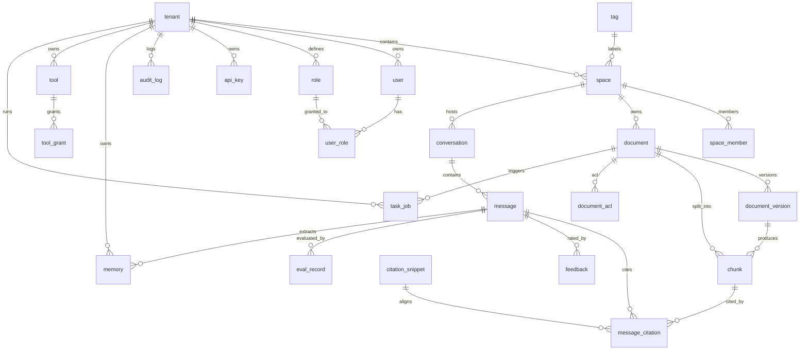

# 数据库设计

## 文档元信息

| 项 | 内容 |
|---|---|
| 文档编号 | NKAP-DESIGN-10 |
| 版本 | v0.3 |
| 作者 | AI 助手 |
| 状态 | 基线 |
| 日期 | 2026-10-29 |
| 所属模块 | `kb` / `ingestion` / `memory` / `citation` / `admin` / `openapi` / `tools` |
| 基线依据 | [项目基线与统一约定](../00-项目基线/项目基线与统一约定.md) |
| 技术栈 | Java 21 + Spring Boot 3.2+ + Spring Data JPA + Flyway + HikariCP + PostgreSQL 16/pgvector + Lucene BM25 + Redis + RabbitMQ + MinIO |
| 命名规范 | 表名/字段名英文小写下划线；每表含 `id`(UUID)、`tenant_id`、`created_at`、`updated_at`、`is_deleted` |
| 优先级标注 | 表结构与索引标注 **MVP / V1 / V2** 阶段归属 |

### 变更记录

| 日期 | 版本 | 变更内容 | 变更人 |
|---|---|---|---|
| 2026-10-29 | v0.1 | 初始基线（Python 栈）：选型、ER、16 张核心表、向量/全文索引、RBAC+ACL、Alembic、归档 | AI 助手 |
| 2026-10-29 | v0.2 | 按基线 v0.2 切换为 **Java 生态**：驱动 PgBouncer/asyncpg→HikariCP、Alembic→Flyway/Liquibase、ORM SQLAlchemy→Spring Data JPA、向量库 Qdrant→pgvector（向量列 + HNSW）、全文 pg_trgm→Lucene BM25；表结构、字段语义与权限模型不变，新增 `citation_snippet` 支撑片段级对齐校验 | AI 助手 |
| 2026-10-29 | v0.3 | 一致性修订：`document_acl.grantee_type` 由（user/role）扩展为（user/role/group），与 04 需求 KB-008「角色/用户/用户组」及 12 安全设计对齐；`permission` 枚举沿用 read/download/delete，并与 12 文档删除 principal→grantee 命名统一 | AI 助手 |
| 2026-10-29 | v0.3 | 项目更名：原「知行 ZhiXing / ZX-KAP」正式更名为「星枢 Nexus / NKAP」；工作目录由 新建文件夹 更名为 nexus（D:\homework\projects\nexus） | AI 助手 |

---

## 1. 数据库选型与部署

| 项 | 规格 |
|---|---|
| 引擎 | PostgreSQL 16（含 `pgvector` 扩展，向量与业务数据同库） |
| 部署 | 一主一从（流复制），主写从读；读写分离由应用侧路由 |
| 连接池 | **HikariCP**（Spring Boot 默认），`maximumPoolSize=20/实例`，`connectionTimeout=30s` |
| 高可用 | Patroni 管理主从切换，VIP 漂移；`readonly` 只读副本承接报表与评估查询 |
| 备份 | 每日全量 + WAL 持续归档，保留 30 天；RPO ≤ 5 分钟，RTO ≤ 30 分钟 |
| 字符集 | `UTF8`，排序 `zh_CN` |
| 扩展 | `pgvector`、`pg_trgm`、`btree_gin`、`pgcrypto` |

连接串示例（不含口令）：`jdbc:postgresql://pg-primary:5432/zxkap?currentSchema=public`。配置要点：`spring.datasource.hikari.*` 显式设置池参数；连接健康检查开启 `connectionTestQuery`；事务隔离级别默认 `READ COMMITTED`，评估/归档任务使用 `REPEATABLE READ`。

---

## 2. 核心 ER 图

> 说明：`chunk` 承载向量列与权限快照；`citation_snippet` 记录答案句子与原文字符区间。

---

## 3. 表结构设计

> 字段表列：字段名｜类型｜约束｜说明。索引与关键查询列于各表之后。

### 3.1 `tenant` 租户

用途：多租户隔离单元，企业级数据边界。

| 字段名 | 类型 | 约束 | 说明 |
|---|---|---|---|
| id | UUID | PK | 租户主键 |
| code | VARCHAR(32) | NOT NULL UNIQUE | 租户编码 |
| name | VARCHAR(128) | NOT NULL | 租户名称 |
| status | VARCHAR(16) | NOT NULL DEFAULT 'active' | active/suspended/deleted |
| plan | VARCHAR(16) | NOT NULL DEFAULT 'standard' | 套餐（影响配额） |
| max_documents | INT | NOT NULL DEFAULT 10000 | 文档上限 |
| max_qps | INT | NOT NULL DEFAULT 50 | 检索 QPS 上限 |
| created_at / updated_at | TIMESTAMPTZ | NOT NULL | 时间戳 |

索引：`UNIQUE(code)`；关键查询：按 `code` 取租户、按状态列出租户。

### 3.2 `space` 空间

用途：知识库空间（部门/项目维度），权限与检索边界。

| 字段名 | 类型 | 约束 | 说明 |
|---|---|---|---|
| id | UUID | PK | 空间主键 |
| tenant_id | UUID | FK→tenant, NOT NULL | 所属租户 |
| name | VARCHAR(128) | NOT NULL | 空间名 |
| description | TEXT | | 描述 |
| visibility | VARCHAR(16) | NOT NULL DEFAULT 'private' | public/private |
| tag_ids | UUID[] | NOT NULL DEFAULT '{}' | 空间标签 |
| created_by | UUID | FK→user | 创建人 |
| created_at / updated_at | TIMESTAMPTZ | NOT NULL | 时间戳 |
| is_deleted | BOOLEAN | NOT NULL DEFAULT false | 软删除 |

索引：`(tenant_id, visibility)`、`(tenant_id, is_deleted)`；关键查询：用户可见空间列表。

### 3.3 `document` 文档

用途：文档元数据主记录，聚合版本与切分。

| 字段名 | 类型 | 约束 | 说明 |
|---|---|---|---|
| id | UUID | PK | 文档主键 |
| tenant_id | UUID | FK→tenant, NOT NULL | 租户 |
| space_id | UUID | FK→space, NOT NULL | 空间 |
| title | VARCHAR(512) | NOT NULL | 标题 |
| source_type | VARCHAR(32) | NOT NULL | upload/url/api/... |
| source_url | TEXT | | 来源地址 |
| content_hash | CHAR(64) | NOT NULL | SHA-256，去重依据 |
| status | VARCHAR(24) | NOT NULL DEFAULT 'pending' | pending/parsing/indexing/ready/failed/quarantined |
| current_version | INT | NOT NULL DEFAULT 1 | 当前版本号 |
| tag_ids | UUID[] | NOT NULL DEFAULT '{}' | 文档标签 |
| created_by | UUID | FK→user | 上传人 |
| created_at / updated_at | TIMESTAMPTZ | NOT NULL | 时间戳 |
| is_deleted | BOOLEAN | NOT NULL DEFAULT false | 软删除 |

索引：`UNIQUE(tenant_id, space_id, content_hash)`、`(tenant_id, space_id, status)`；关键查询：空间内文档列表（分页）、按状态批量扫描待处理文档。

### 3.4 `document_version` 文档版本

用途：保留文档历史版本，支持回滚与增量更新。

| 字段名 | 类型 | 约束 | 说明 |
|---|---|---|---|
| id | UUID | PK | 版本主键 |
| document_id | UUID | FK→document, NOT NULL | 所属文档 |
| tenant_id | UUID | FK→tenant, NOT NULL | 租户（冗余加速过滤） |
| version_no | INT | NOT NULL | 版本号（从 1 递增） |
| content_hash | CHAR(64) | NOT NULL | 版本内容哈希 |
| object_key | TEXT | NOT NULL | MinIO 对象键 |
| status | VARCHAR(24) | NOT NULL | 该版本处理状态 |
| is_current | BOOLEAN | NOT NULL DEFAULT false | 是否当前生效版本 |
| superseded_at | TIMESTAMPTZ | | 被取代时间 |
| created_at | TIMESTAMPTZ | NOT NULL | 创建时间 |

索引：`(document_id, version_no)`、`(tenant_id, is_current)`；关键查询：取文档当前版本、版本回滚。

### 3.5 `chunk` 切分块

用途：最小可检索单元，承载向量列与权限快照。

| 字段名 | 类型 | 约束 | 说明 |
|---|---|---|---|
| id | UUID | PK | 片段主键 |
| tenant_id | UUID | FK→tenant, NOT NULL | 租户 |
| space_id | UUID | FK→space, NOT NULL | 空间 |
| document_id | UUID | FK→document, NOT NULL | 文档 |
| version_id | UUID | FK→document_version, NOT NULL | 版本 |
| seq_no | INT | NOT NULL | 片段序号 |
| heading_path | VARCHAR(512) | | 标题路径 |
| text | TEXT | NOT NULL | 片段正文 |
| token_len | INT | NOT NULL | Token 长度 |
| embedding | vector(1024) | | bge-m3 向量（pgvector） |
| acl_tags | UUID[] | NOT NULL DEFAULT '{}' | 标签级权限 |
| visibility | VARCHAR(16) | NOT NULL DEFAULT 'inherit' | 可见性 |
| status | VARCHAR(16) | NOT NULL DEFAULT 'active' | active/superseded/deleted |
| created_at / updated_at | TIMESTAMPTZ | NOT NULL | 时间戳 |

索引：`(tenant_id, space_id, document_id, status)`、`(tenant_id, space_id, status)`、GIN(`text`)、HNSW(`embedding`)（见 §4）；关键查询：按文档取 active 片段、按 space 统计片段数、向量 ANN 检索。

### 3.6 `conversation` 会话

用途：会话主记录，承载短期记忆与检索缓存。

| 字段名 | 类型 | 约束 | 说明 |
|---|---|---|---|
| id | UUID | PK | 会话主键 |
| tenant_id | UUID | FK→tenant, NOT NULL | 租户 |
| space_id | UUID | FK→space, NOT NULL | 空间（可空表示跨空间） |
| user_id | UUID | FK→user, NOT NULL | 用户 |
| title | VARCHAR(256) | | 会话标题 |
| status | VARCHAR(16) | NOT NULL DEFAULT 'active' | active/archived/closed |
| summary | TEXT | | 压缩摘要 |
| message_count | INT | NOT NULL DEFAULT 0 | 消息数 |
| created_at / updated_at | TIMESTAMPTZ | NOT NULL | 时间戳 |
| is_deleted | BOOLEAN | NOT NULL DEFAULT false | 软删除 |

索引：`(tenant_id, user_id, updated_at DESC)`；关键查询：用户会话列表、按空间取活跃会话。

### 3.7 `message` 消息

用途：会话内单条消息（提问/回答）。

| 字段名 | 类型 | 约束 | 说明 |
|---|---|---|---|
| id | UUID | PK | 消息主键 |
| tenant_id | UUID | FK→tenant, NOT NULL | 租户 |
| conversation_id | UUID | FK→conversation, NOT NULL | 会话 |
| role | VARCHAR(16) | NOT NULL | user/assistant/system/tool |
| content | TEXT | NOT NULL | 正文 |
| tool_calls | JSONB | | 工具调用记录 |
| tool_call_id | VARCHAR(64) | | 关联工具调用 |
| citations | JSONB | | 引用 ID 快照 |
| tokens_in / tokens_out | INT | | Token 统计 |
| model | VARCHAR(64) | | 生成模型 |
| trace_id | VARCHAR(64) | | Langfuse trace |
| created_at | TIMESTAMPTZ | NOT NULL | 创建时间 |

索引：`(conversation_id, created_at)`、`(tenant_id, created_at)`；关键查询：取会话最近 N 条消息、按 trace 查全链路。

### 3.8 `message_citation` 消息引用

用途：答案到原文片段的可验证映射。

| 字段名 | 类型 | 约束 | 说明 |
|---|---|---|---|
| id | UUID | PK | 引用主键 |
| message_id | UUID | FK→message, NOT NULL | 消息 |
| tenant_id | UUID | FK→tenant, NOT NULL | 租户 |
| citation_id | VARCHAR(64) | NOT NULL | 引用编号 C{chunk_id} |
| chunk_id | UUID | FK→chunk, NOT NULL | 片段 |
| document_id | UUID | FK→document, NOT NULL | 文档 |
| space_id | UUID | FK→space, NOT NULL | 空间 |
| snippet | TEXT | | 原文摘要 |
| score | NUMERIC(5,4) | | Rerank 分数 |
| status | VARCHAR(16) | NOT NULL DEFAULT 'valid' | valid/invalid/unsupported |
| created_at | TIMESTAMPTZ | NOT NULL | 创建时间 |

索引：`(message_id, citation_id)`、`(chunk_id)`；关键查询：按消息取引用列表、按 chunk 统计引用数。

### 3.9 `citation_snippet` 引用片段

用途：答案句子与原文字符区间的对齐记录，支撑片段级高亮与 NLI 校验。

| 字段名 | 类型 | 约束 | 说明 |
|---|---|---|---|
| id | UUID | PK | 片段主键 |
| message_citation_id | UUID | FK→message_citation, NOT NULL | 所属引用 |
| tenant_id | UUID | FK→tenant, NOT NULL | 租户 |
| sentence_idx | INT | NOT NULL | 答案句子序号 |
| char_start / char_end | INT | NOT NULL | 原文字符区间 |
| sentence | TEXT | NOT NULL | 被引用的答案句 |
| support_score | NUMERIC(5,4) | | NLI 支撑分 |
| created_at | TIMESTAMPTZ | NOT NULL | 创建时间 |

索引：`(message_citation_id, sentence_idx)`；关键查询：按引用取对齐片段、校验失败句子汇总。

### 3.10 `tool` 工具

用途：内置工具与 MCP 工具元数据。

| 字段名 | 类型 | 约束 | 说明 |
|---|---|---|---|
| id | UUID | PK | 工具主键 |
| tenant_id | UUID | FK→tenant, NOT NULL | 租户（内置工具为 global） |
| name | VARCHAR(128) | NOT NULL | 工具名 |
| kind | VARCHAR(16) | NOT NULL | builtin/mcp |
| endpoint | TEXT | | MCP endpoint 或本地标识 |
| schema | JSONB | NOT NULL | 参数 JSON Schema |
| requires_approval | BOOLEAN | NOT NULL DEFAULT false | 是否需审批 |
| risk_level | VARCHAR(16) | NOT NULL DEFAULT 'low' | low/medium/high |
| status | VARCHAR(16) | NOT NULL DEFAULT 'enabled' | enabled/disabled |
| created_at / updated_at | TIMESTAMPTZ | NOT NULL | 时间戳 |

索引：`UNIQUE(tenant_id, name)`、`(tenant_id, kind, status)`；关键查询：启用工具列表、按 kind 过滤。

### 3.11 `tool_grant` 工具授权

用途：工具级 RBAC / 用户级授权。

| 字段名 | 类型 | 约束 | 说明 |
|---|---|---|---|
| id | UUID | PK | 授权主键 |
| tenant_id | UUID | FK→tenant, NOT NULL | 租户 |
| tool_id | UUID | FK→tool, NOT NULL | 工具 |
| grant_type | VARCHAR(16) | NOT NULL | role/user |
| grantee_id | UUID | NOT NULL | 角色 ID 或用户 ID |
| permission | VARCHAR(16) | NOT NULL DEFAULT 'use' | use/approve/manage |
| auto_approve | BOOLEAN | NOT NULL DEFAULT false | 是否免审批 |
| created_at | TIMESTAMPTZ | NOT NULL | 创建时间 |

索引：`(tenant_id, tool_id, grant_type)`、`(grantee_id, grant_type)`；关键查询：判断用户是否具备工具权限。

### 3.12 `api_key` API 密钥

用途：开放平台调用凭证。

| 字段名 | 类型 | 约束 | 说明 |
|---|---|---|---|
| id | UUID | PK | 主键 |
| tenant_id | UUID | FK→tenant, NOT NULL | 租户 |
| name | VARCHAR(128) | NOT NULL | 名称 |
| key_prefix | VARCHAR(16) | NOT NULL | 明文前缀（展示用） |
| key_hash | CHAR(64) | NOT NULL | SHA-256 哈希 |
| scopes | TEXT[] | NOT NULL DEFAULT '{}' | 授权范围 |
| expires_at | TIMESTAMPTZ | | 过期时间（空=永久） |
| last_used_at | TIMESTAMPTZ | | 最近使用 |
| status | VARCHAR(16) | NOT NULL DEFAULT 'active' | active/revoked |
| created_by | UUID | FK→user | 创建人 |
| created_at / updated_at | TIMESTAMPTZ | NOT NULL | 时间戳 |

索引：`UNIQUE(tenant_id, key_prefix)`、`(key_hash)`；关键查询：校验 API Key、按租户列出。

### 3.13 `audit_log` 审计日志

用途：不可篡改的操作与合规审计。

| 字段名 | 类型 | 约束 | 说明 |
|---|---|---|---|
| id | BIGINT | PK GENERATED | 自增主键 |
| tenant_id | UUID | NOT NULL | 租户 |
| actor_id | UUID | | 操作者 |
| actor_type | VARCHAR(16) | | user/api_key/system |
| action | VARCHAR(64) | NOT NULL | 动作（如 document.delete） |
| resource_type | VARCHAR(32) | | 资源类型 |
| resource_id | VARCHAR(64) | | 资源 ID |
| detail | JSONB | | 详情 |
| ip | INET | | 来源 IP |
| trace_id | VARCHAR(64) | | 链路 ID |
| created_at | TIMESTAMPTZ | NOT NULL DEFAULT now() | 时间 |

索引：`(tenant_id, created_at DESC)`、`(actor_id, created_at)`、`(action)`；关键查询：按时间/操作者检索审计。

### 3.14 `feedback` 反馈

用途：用户对答案的满意度与纠错。

| 字段名 | 类型 | 约束 | 说明 |
|---|---|---|---|
| id | UUID | PK | 主键 |
| tenant_id | UUID | FK→tenant, NOT NULL | 租户 |
| message_id | UUID | FK→message, NOT NULL | 消息 |
| user_id | UUID | FK→user | 反馈人 |
| rating | SMALLINT | NOT NULL | 1-5 分 |
| comment | TEXT | | 文本反馈 |
| reason | VARCHAR(64) | | 原因标签（不准确/无关/...） |
| created_at | TIMESTAMPTZ | NOT NULL | 创建时间 |

索引：`(message_id)`、`(tenant_id, rating)`；关键查询：按消息聚合评分、导出低分样本。

### 3.15 `eval_record` 评估记录

用途：RAG 质量离线/在线评估结果。

| 字段名 | 类型 | 约束 | 说明 |
|---|---|---|---|
| id | UUID | PK | 主键 |
| tenant_id | UUID | FK→tenant, NOT NULL | 租户 |
| message_id | UUID | FK→message | 关联消息（可空） |
| dataset_id | UUID | | 离线数据集 |
| eval_type | VARCHAR(32) | NOT NULL | offline/online |
| faithfulness | NUMERIC(5,4) | | 忠实度 |
| citation_accuracy | NUMERIC(5,4) | | 引用准确率 |
| recall_at_10 | NUMERIC(5,4) | | 召回率 |
| is_grounded | BOOLEAN | | 是否有依据 |
| model | VARCHAR(64) | | 被评模型 |
| detail | JSONB | | 明细 |
| created_at | TIMESTAMPTZ | NOT NULL | 创建时间 |

索引：`(eval_type, created_at)`、`(tenant_id, citation_accuracy)`；关键查询：按时间统计质量趋势、导出回归报告。

### 3.16 `memory` 记忆

用途：长期记忆（偏好/事实/待办）。

| 字段名 | 类型 | 约束 | 说明 |
|---|---|---|---|
| id | UUID | PK | 主键 |
| tenant_id | UUID | FK→tenant, NOT NULL | 租户 |
| user_id | UUID | FK→user, NOT NULL | 用户 |
| mem_type | VARCHAR(16) | NOT NULL | preference/fact/todo |
| content | TEXT | NOT NULL | 记忆内容 |
| confidence | NUMERIC(4,3) | | 置信度 |
| source_message_id | UUID | FK→message | 来源消息 |
| is_active | BOOLEAN | NOT NULL DEFAULT true | 是否生效 |
| created_at / updated_at | TIMESTAMPTZ | NOT NULL | 时间戳 |

索引：`(tenant_id, user_id, mem_type, is_active)`；关键查询：取用户生效记忆（top5）。

### 3.17 `task_job` 任务作业

用途：异步管线任务（RabbitMQ 消费 / Spring Batch）状态与重试记录。

| 字段名 | 类型 | 约束 | 说明 |
|---|---|---|---|
| id | UUID | PK | 主键 |
| tenant_id | UUID | FK→tenant, NOT NULL | 租户 |
| job_type | VARCHAR(48) | NOT NULL | ingestion/embedding/eval/archive |
| document_id | UUID | FK→document | 关联文档（可空） |
| payload | JSONB | | 任务参数 |
| exchange / routing_key | VARCHAR(64) | | RabbitMQ 交换机 / 路由键 |
| status | VARCHAR(16) | NOT NULL DEFAULT 'pending' | pending/running/success/failed/dead |
| attempt | SMALLINT | NOT NULL DEFAULT 0 | 重试次数 |
| max_attempt | SMALLINT | NOT NULL DEFAULT 5 | 上限 |
| last_error | TEXT | | 最近错误 |
| worker_id | VARCHAR(64) | | 执行 worker |
| started_at / finished_at | TIMESTAMPTZ | | 时间 |
| created_at / updated_at | TIMESTAMPTZ | NOT NULL | 时间戳 |

索引：`(status, job_type)`、`(document_id, created_at)`、`(tenant_id, status)`；关键查询：扫描可重试任务、按文档查任务历史。

---

## 4. 向量与全文索引设计

### 4.1 pgvector 向量索引

| 项 | 规格 |
|---|---|
| 存储 | `chunk.embedding vector(1024)`（bge-m3，与业务库同库），距离 `vector_cosine_ops`（余弦） |
| 主索引（MVP/V1） | HNSW：`CREATE INDEX idx_chunk_embedding_hnsw ON chunk USING hnsw (embedding vector_cosine_ops)`；`m=16`、`ef_construct=100`、查询 `ef=64`（按召回/延迟调优） |
| 备选索引（V1） | IVFFlat：`CREATE INDEX ... USING ivfflat (embedding vector_cosine_ops) WITH (lists=100)`（需先 `ANALYZE`）；数据量 < 50 万优先 HNSW，超大规模评估 IVFFlat |
| 租户隔离 | 向量列与 `tenant_id` 同表，检索条件强制 `tenant_id = ?` 下推，不依赖跨租户逻辑隔离 |

### 4.2 过滤字段（Payload）索引（均建索引以保证谓词下推）

| 字段 | 类型 | 索引 | 用途 |
|---|---|---|---|
| `tenant_id` | UUID | B-Tree | 租户隔离（必建） |
| `space_id` | UUID | B-Tree | 空间过滤（必建） |
| `document_id` | UUID | B-Tree | 文档过滤 |
| `version_id` | UUID | B-Tree | 版本过滤 |
| `acl_tags` | UUID[] | GIN（`array_ops`） | 标签级权限过滤 |
| `status` | VARCHAR | B-Tree | 片段状态过滤 |
| `heading_path` | VARCHAR | GIN（`pg_trgm`） | 标题模糊检索（辅助） |

### 4.3 Lucene BM25 全文索引

| 项 | 规格 |
|---|---|
| 实现 | **Lucene BM25**（本地倒排，`org.apache.lucene.search.BM25Similarity`） |
| 分片 | 按 `tenant_id` 分片目录（`index/{tenant_id}/`），MVP 单租户单分片 |
| 数据源 | `chunk.text` 同步写入，字段 `text`、`heading_path`、`title` |
| 分词 | 中英文混合分词（IK Analyzer / HanLP 中文分词 + 英文空白），字段权重 `title/heading_path` > `text` |
| 过滤 | 使用与 pgvector 相同的 `BooleanQuery` Filter（`tenant_id`、`space_id`、`acl_tags`） |
| 阶段 | MVP 可用 `pg_trgm` + GIN 兜底，V1 切换 Lucene BM25 主通道；V2 扩展多路召回（规则/图谱/表格专用通道） |

---

## 5. 权限数据模型

### 5.1 RBAC 角色与身份表（admin / kb_admin / employee / developer）

| 表名 | 用途 | 关键字段 |
|---|---|---|
| `user` | 平台用户 | `id`、`tenant_id`、`username`、`email`、`status` |
| `role` | 角色定义 | `id`、`tenant_id`、`code`（admin/kb_admin/employee/developer）、`scope_type` |
| `user_role` | 用户-角色绑定 | `user_id`、`role_id`、`space_id`（空=租户级） |
| `space_member` | 空间成员 | `space_id`、`user_id`、`role_id`、`member_role` |

### 5.2 文档级 ACL

| 表名 | 用途 | 关键字段 |
|---|---|---|
| `document_acl` | 文档级授权，覆盖空间默认 | `document_id`、`grantee_type`（user/role/group）、`grantee_id`、`permission`（read/download/delete） |
| 片段继承 | `chunk` 快照继承文档 ACL（`acl_tags` + `visibility`），检索时按快照过滤 | `acl_tags`、`visibility` |

- 空间级：`space.visibility`（public/private）+ `space_member`；文档级：`document_acl` 覆盖空间默认，可授予指定用户/角色/用户组（read/download/delete）。

### 5.3 标签级权限

| 表名 | 用途 | 关键字段 |
|---|---|---|
| `tag` | 标签定义 | `id`、`tenant_id`、`code`、`name`、`description` |
| `tag_grant` | 标签授权 | `tenant_id`、`grantee_type`、`grantee_id`、`tag_id` |

- 用户/角色授予标签后仅能检索到命中其标签集合的片段；无标签片段默认对拥有空间权限者可见。

### 5.4 权限过滤强制注入

检索链路在 pgvector 的 `WHERE` 谓词与 Lucene `BooleanQuery` 中同时注入租户 + 空间 + 标签条件，详见 [09-详细设计-RAG与Agent](09-详细设计-RAG与Agent.md) §3.4。权限变更后通过事件异步刷新 `chunk` 快照，保证一致性。

---

## 6. 数据迁移与版本管理

- 工具：**Flyway**（主），Liquibase（备选，支持更复杂跨库变更）。
- 规范：迁移脚本置于 `src/main/resources/db/migration/`，命名 `V{版本}__{描述}.sql`；`version` 线性递增，`checksum` 校验脚本未被篡改。
- 原则：每次结构变更生成独立迁移；迁移必须可前滚、可回滚（提供 `undo` 或前向修复）。
- 流程：开发分支提交迁移 → 评审 → 随发布执行 → CI 校验迁移链完整。
- 数据修复：大表变更采用「新增列 + 回填 + 切换」，避免长时锁表；向量列回填按批次（`batch_size=500`）提交。
- Spring Data JPA 仅用于实体映射与查询，DDL 一律由 Flyway 管理，禁用 `ddl-auto=update`。

---

## 7. 数据保留与归档策略

| 数据 | 热存储 | 归档 | 删除 |
|---|---|---|---|
| 文档/切分 | MinIO + PG 在线 | 冷存（对象存储归档层） | 按租户策略 |
| 会话/消息 | PG 在线 | 90 天后归档 | 365 天或按租户配置 |
| 审计日志 | PG 在线 | 12 个月后归档 | 按合规保留（≥3 年） |
| 评估记录 | PG 在线 | 12 个月后归档 | 保留样本集 |
| 记忆 | PG 在线 | — | 用户注销时删除 |
| 向量 | pgvector（同库） | 随文档归档同步删除 | 文档删除即删 |

- 归档任务：Quartz/Spring Batch 每日调度，`archive` 状态流转，删除前留审计；审计日志仅追加、禁止物理删除，归档后可离线校验完整性。
- 向量与全文索引随文档状态联动：`chunk.status=deleted` 后异步清理 Lucene 文档与向量行。

---

## 8. 关联文档

- [项目基线与统一约定](../00-项目基线/项目基线与统一约定.md)
- [09-详细设计-RAG与Agent](09-详细设计-RAG与Agent.md)
- [11-接口设计](11-接口设计.md)
- [12-安全与权限设计](12-安全与权限设计.md)
