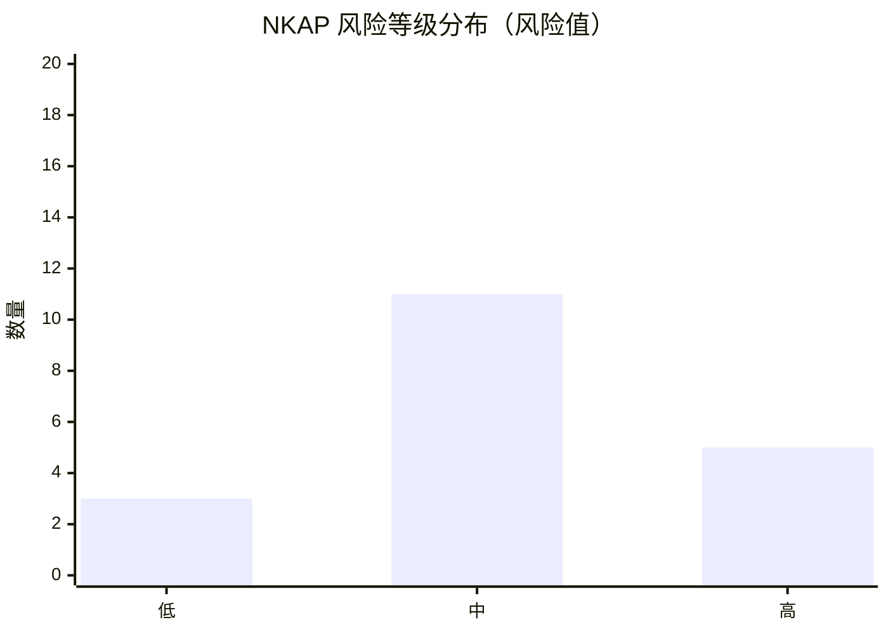

# 14 - 风险登记册

> **项目名称**：星枢 Nexus · 企业智能知识库与问答智能体平台（NKAP）
> **文档版本**：v0.1 ｜ **作者**：AI 助手 ｜ **状态**：基线 ｜ **日期**：2026-10-29

| 元信息 | 内容 |
|---|---|
| 文档编号 | NKAP-RISK-14 |
| 版本 | v0.1 |
| 作者 | AI 助手 |
| 状态 | 基线（待评审冻结） |
| 创建日期 | 2026-10-29 |
| 最后更新 | 2026-10-29 |
| 适用阶段 | Phase 0 ~ Phase 6（当前 Phase 2 设计阶段） |
| 依据基线 | [项目基线与统一约定](../00-项目基线/项目基线与统一约定.md) |

---

## 1. 文档说明

本登记册对 NKAP 项目全生命周期风险进行系统识别、评估与跟踪，是风险应对与升级决策的权威依据。风险编号统一采用 **`RISK-XXX`** 三位序号。

**变更记录**：

| 日期 | 版本 | 变更内容 | 变更人 |
|---|---|---|---|
| 2026-10-29 | v0.1 | 初始识别 19 项风险，完成评估与应对策略 | AI 助手 |
| 2026-10-29 | v0.2 | 技术栈切换为 Java 生态：RISK-003/004/006/015 等技术细节改为 Java 组件（向量库→pgvector/Milvus、文档解析→Apache Tika+PDFBox+POI+Tesseract/PaddleOCR、LangGraph→LangGraph4j）；风险编号、概率影响矩阵、风险值与等级不变 | 用户决策 + AI |
| 2026-10-29 | v0.2 | 项目更名：原「知行 ZhiXing / ZX-KAP」正式更名为「星枢 Nexus / NKAP」；工作目录由 新建文件夹 更名为 nexus（D:\homework\projects\nexus） | AI 助手 |

---

## 2. 风险管理方法

### 2.1 风险管理流程

风险管理遵循 **识别 → 评估 → 应对 → 监控** 四步闭环：

| 步骤 | 活动 | 输入 | 输出 |
|---|---|---|---|
| 识别 | 头脑风暴、专家访谈、历史复盘、头脑风暴清单 | 项目计划、需求、架构 | 风险清单 |
| 评估 | 概率影响矩阵打分，确定风险值与等级 | 风险清单 | 风险优先级排序 |
| 应对 | 制定规避/减轻/转移/接受策略与责任人 | 评估结果 | 应对措施 |
| 监控 | 定期评审、触发器监控、升级与关闭 | 应对措施 | 状态更新 |

### 2.2 评估口径

- **概率**：高（≥60%）、中（20%~60%）、低（<20%）。
- **影响**：高（导致目标严重偏离，如上线延期 >2 周、重大安全事件）、中（部分偏离）、低（可控）。
- **风险值** = 概率分 × 影响分（各取 高=3 / 中=2 / 低=1）。
- **等级**：风险值 6~9 为 **高**，3~4 为 **中**，1~2 为 **低**。

### 2.3 应对策略定义

| 策略 | 含义 | 适用场景 |
|---|---|---|
| 规避（Avoid） | 改变方案消除风险根源 | 高风险且代价可承受 |
| 减轻（Mitigate） | 降低概率或影响 | 可部分控制的风险 |
| 转移（Transfer） | 外包、保险或第三方承担 | 专业性强或成本类风险 |
| 接受（Accept） | 主动/被动承担并备应急 | 低优先级或收益大于代价 |

### 2.4 风险识别方法

| 方法 | 说明 | 适用 |
|---|---|---|
| 头脑风暴 | 跨职能团队集中识别技术/需求/安全/进度/运营风险 | 阶段启动与迭代复盘 |
| 专家访谈 | 架构师、安全专家对关键技术风险独立评估 | 设计冻结前 |
| 历史复盘 | 参照同类知识库/Agent 项目的经验教训 | 每个 Gate |
| 检查清单 | 按模块（kb/ingestion/retrieval/agent/tools/memory/citation/admin/openapi）逐项核对 | 常规 |
| 假设分析 | 检验关键假设（如「检索准确率可达 90%」）是否成立 | 里程碑 |

### 2.5 评估示例

以 RISK-001 模型幻觉为例：概率判定为 **高**（历史上幻觉为普遍现象，预估 ≥60% 会出现），影响判定为 **高**（直接违背「可溯源」核心目标，可能引发客户投诉），风险值 = 3×3 = 9，等级 **高**，须制定专项应对与应急预案。

---

## 3. 风险登记册

> 风险值以数值表示（1~9）；等级分为 高 / 中 / 低。状态：开放 / 监控中 / 已关闭。

| 编号 | 类别 | 风险描述 | 触发条件 | 概率 | 影响 | 风险值 | 应对策略 | 具体措施 | 责任人 | 状态 | 等级 |
|---|---|---|---|---|---|---|---|---|---|---|---|
| RISK-001 | 技术 | 模型幻觉导致生成无依据、错误答案，损害可信度 | 检索召回不足或提示约束不足时生成超纲内容 | 高 | 高 | 9 | 减轻 | 强制引用校验+拒绝回答机制；无依据回答率≤5%门禁 | 算法工程师 | 开放 | 高 |
| RISK-002 | 技术 | RAG 检索质量不达标，召回不相关片段 | 评估集引用准确率 <85% 或 Rerank 无效 | 高 | 高 | 9 | 减轻 | 混合检索+Rerank 调优；每周评估门禁；A/B 对照 | 算法工程师 | 开放 | 高 |
| RISK-003 | 技术 | pgvector 向量库在万级文档下检索延迟超标 | 文档规模 >5万 或并发 >200 时 P95 超时 | 中 | 中 | 4 | 减轻 | pgvector HNSW 索引与分区调优、过滤条件下推；压测基线；必要时切换 Milvus 托管方案 | 架构师 | 监控中 | 中 |
| RISK-004 | 技术 | 复杂格式文档（扫描件/复杂表格/多栏 PDF）解析错乱 | 解析失败率 >10% 或关键内容丢失 | 高 | 中 | 6 | 减轻 | Apache Tika+PDFBox+POI 多解析器组合；Tesseract/PaddleOCR OCR 兜底；解析质量抽检 | 后端工程师 | 开放 | 高 |
| RISK-005 | 技术 | MCP 生态不成熟，标准不一致导致工具接入受阻 | MCP 规范变更或第三方 Server 兼容性差 | 中 | 中 | 4 | 减轻 | 自研适配网关；保留 REST 直连兜底 | 架构师 | 监控中 | 中 |
| RISK-006 | 技术 | LangGraph4j 状态图复杂度失控，调试与维护困难 | 状态节点 >10 或人工审批回环引入死循环 | 中 | 中 | 4 | 减轻 | 状态图评审；分图拆解；trace 全链路可观测 | 算法工程师 | 监控中 | 中 |
| RISK-007 | 需求 | 需求蔓延，范围失控导致进度延误 | 迭代中 Must 条目新增 >10% 或无变更评审 | 高 | 中 | 6 | 规避 | 冻结需求基线；变更控制流程；MoSCoW 分级把关 | 产品经理 | 开放 | 高 |
| RISK-008 | 需求 | 权限模型（4 角色×空间×文档）复杂，实现易出错 | 权限矩阵用例未全覆盖或出现越权 | 中 | 高 | 6 | 减轻 | 统一 RBAC+ABAC；权限测试全覆盖；最小权限默认 | 架构师 | 开放 | 高 |
| RISK-009 | 需求 | 知识更新同步滞后，员工看到过期答案 | 文档更新后索引延迟 >24h 或未触发增量更新 | 中 | 中 | 4 | 减轻 | 增量更新+失效通知；更新延迟监控 | 后端工程师 | 监控中 | 中 |
| RISK-010 | 安全合规 | 私有化部署数据泄露（原文、向量、日志外泄） | 对象存储/日志未加密或访问控制缺失 | 低 | 高 | 3 | 减轻 | 传输与存储加密；密钥托管；日志脱敏 | 运维工程师 | 监控中 | 中 |
| RISK-011 | 安全合规 | 越权访问，员工访问非授权知识或工具 | 权限校验缺失或 API 未做服务端鉴权 | 中 | 高 | 6 | 减轻 | 服务端强制鉴权；越权测试用例；审计日志 | 后端工程师 | 开放 | 高 |
| RISK-012 | 安全合规 | 生成内容触碰合规红线（敏感/不当内容） | 无内容安全过滤或模型输出违规 | 中 | 高 | 6 | 减轻 | 内容安全过滤层；敏感词与策略拦截；人工复核 | 产品经理 | 开放 | 高 |
| RISK-013 | 安全合规 | 未通过企业/行业合规审查（数据出境、备案） | 合规审计发现不合规项 | 低 | 高 | 3 | 转移 | 引入合规顾问；提前开展合规预审 | 产品经理 | 监控中 | 中 |
| RISK-014 | 进度 | 关键角色人力不足或流失 | 关键路径人员到岗率 <80% 或离职 | 中 | 高 | 6 | 减轻 | 关键角色冗余备份；提前 2 周预警；外包储备 | 项目经理 | 开放 | 高 |
| RISK-015 | 进度 | 外部依赖阻塞（模型/pgvector 向量库/第三方工具不可用） | 供应商接口变更或服务不可用 | 中 | 中 | 4 | 减轻 | 多模型（DeepSeek/Qwen/Ollama）与向量库（pgvector→Milvus）备选；依赖监控与降级预案 | 架构师 | 监控中 | 中 |
| RISK-016 | 进度 | 测试环境与生产不一致，缺陷漏测 | 环境差异导致压测/安全测试失效 | 中 | 中 | 4 | 减轻 | 环境一致性基线；容器化测试环境；预发环境验证 | 测试工程师 | 监控中 | 中 |
| RISK-017 | 运营 | 用户接受度低，系统使用率不达预期 | 上线 3 个月活跃用户 <30% | 中 | 中 | 4 | 减轻 | 上线培训与推广；收集反馈快速迭代 | 产品经理 | 监控中 | 中 |
| RISK-018 | 运营 | 平台维护成本超预期（算力/人力） | 单次问答成本或运维工时高于预算 | 中 | 中 | 4 | 减轻 | 模型成本优化；缓存复用；自动化运维 | 运维工程师 | 监控中 | 中 |
| RISK-019 | 运营 | 模型 API 成本上升或涨价 | 供应商调价或调用量激增 | 中 | 中 | 4 | 转移 | 签订量价协议；本地模型兜底降本 | 项目经理 | 监控中 | 中 |

### 3.1 类别覆盖度统计

| 类别 | 数量 | 编号 | 最高等级 |
|---|---|---|---|
| 技术风险 | 6 | RISK-001 ~ RISK-006 | 高 |
| 需求风险 | 3 | RISK-007 ~ RISK-009 | 高 |
| 安全合规 | 4 | RISK-010 ~ RISK-013 | 高 |
| 进度风险 | 3 | RISK-014 ~ RISK-016 | 高 |
| 运营风险 | 3 | RISK-017 ~ RISK-019 | 中 |

> 覆盖度核对：技术（模型幻觉、RAG 检索、pgvector 向量库、Apache Tika 文档解析、MCP、LangGraph4j）、需求（蔓延、权限模型、知识更新）、安全合规（泄露、越权、内容安全、合规审查）、进度（人力、依赖、测试环境）、运营（接受度、维护成本、模型成本）均已覆盖。

---

## 4. 概率影响矩阵

### 4.1 矩阵（行=概率，列=影响，单元格=风险值）

| 概率 \ 影响 | 低（1） | 中（2） | 高（3） |
|---|---|---|---|
| **高（3）** | 3 | 6 | 9 |
| **中（2）** | 2 | 4 | 6 |
| **低（1）** | 1 | 2 | 3 |

> 图例：**9/6 = 高（重大，红色）**｜**3/4 = 中（黄色）**｜**1/2 = 低（绿色）**

### 4.2 分布图（Mermaid）

> 说明：截至 v0.1，共识别 19 项风险，其中高等级 8 项、中等级 11 项、低等级 0 项。

---

## 5. 重点风险应对详述（Top 5）

### 5.1 RISK-001 模型幻觉（风险值 9，高）

- **背景**：LLM 可能生成检索片段之外的内容，直接违背「答案可溯源」的北极星指标。
- **方案**：
  1. 上下文仅注入经过权限过滤与 Rerank 的片段，禁止模型自由发挥；
  2. 生成后执行 **引用校验**，无匹配片段则返回「无法回答」并给出建议路径；
  3. 提示词中明确「无依据不得回答」的硬约束。
- **验证方法**：离线评估集统计无依据回答率（门禁 ≤5%）；抽样 200 条人工复核引用正确性。
- **应急预案**：模型输出触发幻觉检测阈值时，自动降级为「仅返回检索原文片段 + 链接」，并通知算法工程师。

### 5.2 RISK-002 RAG 检索质量不达标（风险值 9，高）

- **背景**：混合检索、Rerank、查询改写任一环节失效，都会降低引用准确率。
- **方案**：
  1. 建立 **分层评估集**（简单/复杂/跨文档问题）；
  2. 每周运行评估，指标劣化 >3% 触发回滚；
  3. 检索参数（chunk 大小、Top-K、融合权重）做正交调优。
- **验证方法**：引用准确率 ≥90% 门禁；Recall@10、MRR 作为过程指标。
- **应急预案**：短期以增大 Top-K + 人工精选语料缓解；中期切换 Reranker 或引入语义重写。

### 5.3 RISK-007 需求蔓延（风险值 6，高）

- **背景**：企业客户在迭代中持续追加需求，易冲垮既定迭代范围。
- **方案**：
  1. 冻结需求基线，Must/Should 条目纳入迭代；
  2. 所有新增需求走 **变更控制流程**，评估工期与影响后排期；
  3. PM 每迭代发布范围确认单。
- **验证方法**：迭代内 Must 条目新增率 ≤10%；变更均经评审。
- **应急预案**：若必须承接，则启动 **范围-进度置换**（延期或裁剪低优先级项），并书面确认。

### 5.4 RISK-008 权限模型复杂（风险值 6，高）

- **背景**：4 种角色 × 空间 × 文档级权限矩阵复杂度高，越权风险大。
- **方案**：
  1. 采用 RBAC（角色）+ ABAC（资源属性）组合，默认最小权限；
  2. 检索阶段即做 **权限过滤**（filtered search），而非生成后拦截；
  3. 权限决策下沉服务端，前端不可信。
- **验证方法**：权限矩阵用例 100% 覆盖；安全测试含越权尝试用例。
- **应急预案**：发现越权缺陷立即下线相关接口，切换为全量权限过滤的保守模式。

### 5.5 RISK-011 越权访问（风险值 6，高）

- **背景**：API 若仅做前端校验，攻击者可绕过获取非授权知识。
- **方案**：
  1. 所有 OpenAPI 接口服务端强制鉴权（JWT/API Key）；
  2. 检索结果逐条校验用户可见范围；
  3. 越权行为全量审计并告警。
- **验证方法**：安全测试覆盖水平越权与垂直越权；渗透测试至少一轮。
- **应急预案**：确认越权事件后立即封禁相关账号、吊销 Token，启动安全事件响应流程并上报。

### 5.6 重点风险跟踪表

| 编号 | 风险值 | 应对策略 | 责任人 | 最近检查点 | 下步动作 |
|---|---|---|---|---|---|
| RISK-001 | 9 | 减轻 | 算法工程师 | 设计冻结（T0+8周） | 设计引用校验方案 |
| RISK-002 | 9 | 减轻 | 算法工程师 | 设计冻结（T0+8周） | 建立分层评估集 |
| RISK-007 | 6 | 规避 | 产品经理 | 需求冻结（T0+4周） | 变更控制流程落地 |
| RISK-008 | 6 | 减轻 | 架构师 | 设计冻结（T0+8周） | 权限模型设计评审 |
| RISK-011 | 6 | 减轻 | 后端工程师 | 设计冻结（T0+8周） | 鉴权方案纳入接口设计 |

---

## 6. 风险监控机制

### 6.1 评审频率

| 活动 | 频率 | 参与人 | 输出 |
|---|---|---|---|
| 风险周会 | 每周 | PM+AR+各模块负责人 | 风险状态更新 |
| 里程碑风险评审 | 每个 Gate | PM+AR+QA | 风险再评估 |
| 风险专项复盘 | 每迭代结束 | 全体 | 新增/关闭风险 |

### 6.2 触发器

1. **技术触发**：引用准确率 <85%、无依据回答率 >8%、解析失败率 >10%。
2. **进度触发**：关键路径延期 >1 周、里程碑延期 >1 周。
3. **安全触发**：出现越权、数据泄露事件或安全测试未通过。
4. **需求触发**：迭代内 Must 条目新增 >10%。

### 6.3 升级路径

| 等级 | 处理人 | 时限 |
|---|---|---|
| 低 | 模块负责人 | 迭代内处理 |
| 中 | 项目经理 | 1 周内制定措施 |
| 高（≥6） | 项目指导委员会（+ 发起人） | 3 个工作日内决策 |

**升级规则**：

1. 风险等级上升或连续 2 周无改善，自动升级；
2. 高风险须有明确责任人与缓解计划，否则在周会公开通报；
3. 触发器命中即启动对应应急预案，不等待例行评审。

---

## 7. 关联文档

- [项目基线与统一约定](../00-项目基线/项目基线与统一约定.md)
- [13-项目计划与里程碑](./13-项目计划与里程碑.md)
- [04-需求规格说明书](../02-需求分析/04-需求规格说明书.md)
- [05-系统架构设计](../03-系统设计/05-系统架构设计.md)
- [08-Agent 编排设计](../03-系统设计/08-Agent编排设计.md)
- [06-数据库设计](../03-系统设计/06-数据库设计.md)
